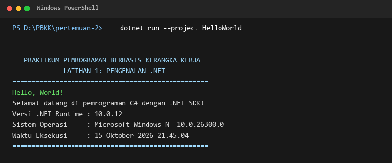
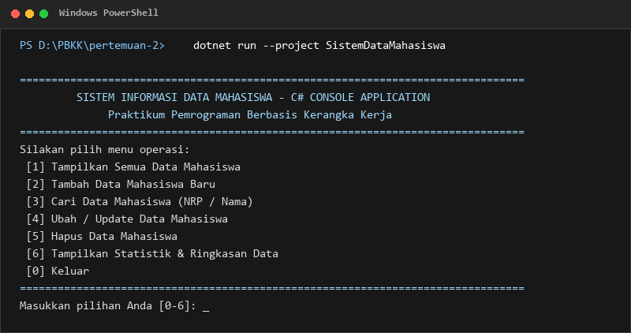
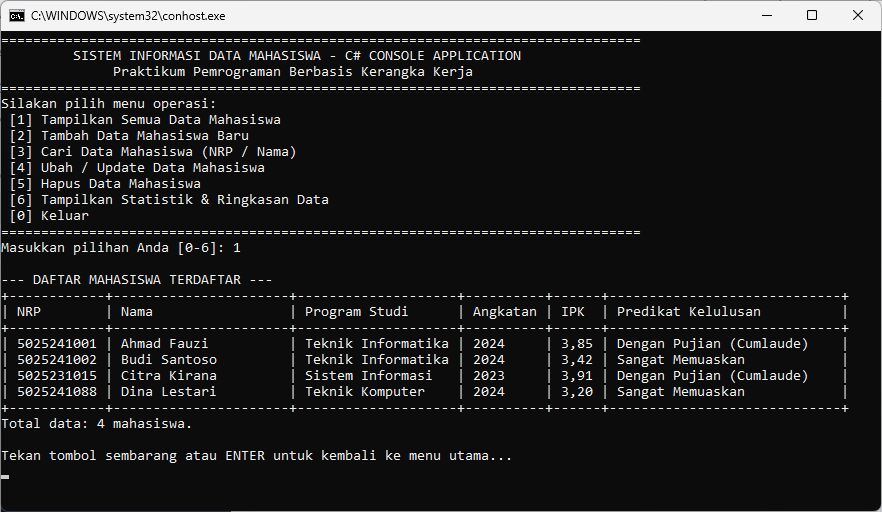
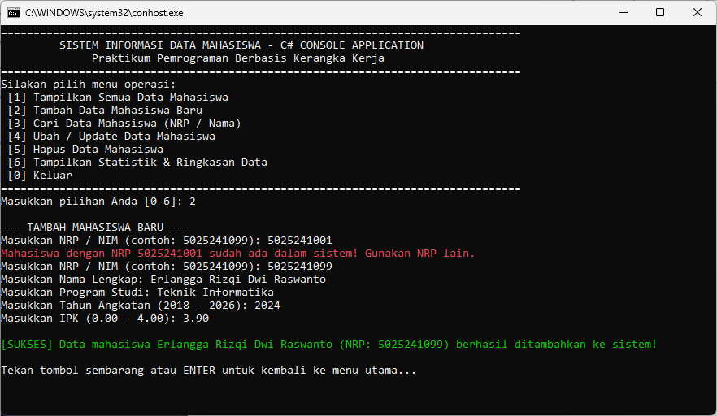
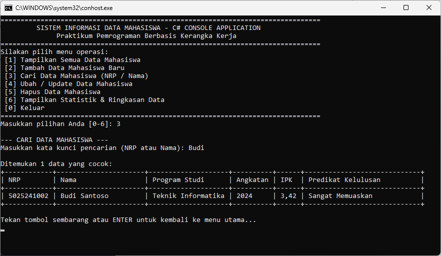
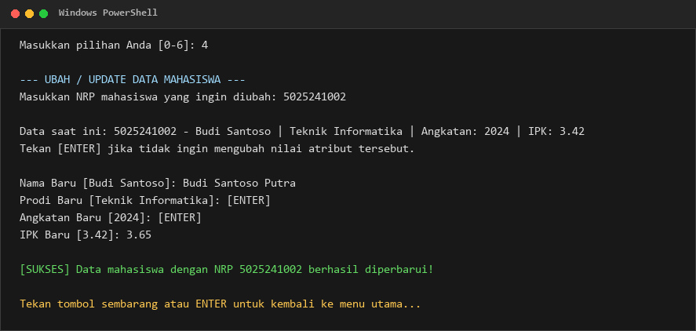
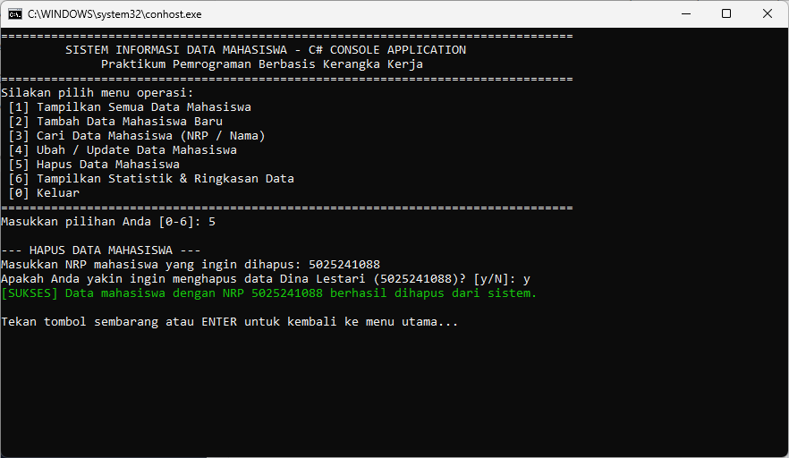
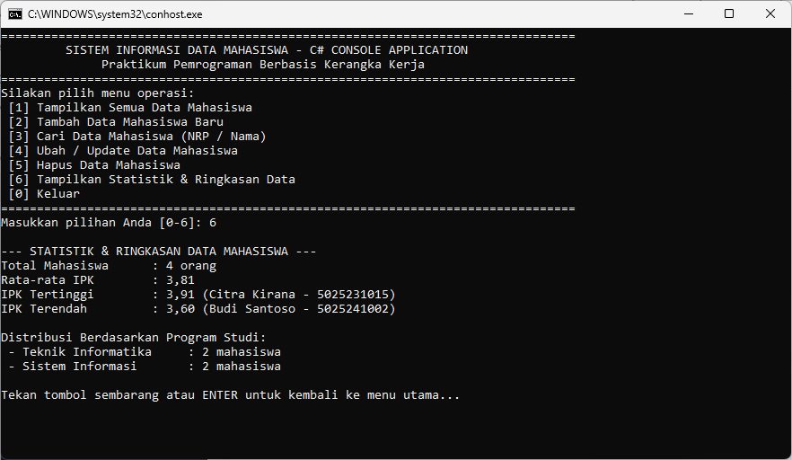

# Pertemuan 2: Latihan 1 - Pengenalan .NET Framework & C# Console

> **Mata Kuliah:** Pemrograman Berbasis Kerangka Kerja (PBKK)  
> **Topik:** Pengenalan .NET SDK, Arsitektur Dasar, dan Pembuatan Aplikasi Console C#  
> **Framework:** .NET 10.0 / C#  

---

## 📋 Deskripsi Praktikum

Praktikum Pertemuan 2 (Latihan 1) berfokus pada pengenalan dasar ekosistem **.NET Framework / .NET SDK** serta pemrograman menggunakan bahasa **C#**. Pada praktikum ini dikembangkan dua proyek aplikasi console:

1. **`HelloWorld`**: Program pengenalan dasar untuk memverifikasi lingkungan instalasi .NET SDK, arsitektur *Common Language Runtime* (CLR), dan mencetak informasi lingkungan sistem.
2. **`SistemDataMahasiswa`**: Aplikasi console interaktif untuk manajemen data mahasiswa yang menerapkan konsep **Pemrograman Berorientasi Objek (OOP)**, struktur data koleksi (`List<T>`), validasi input, serta operasi lengkap **CRUD** (*Create, Read, Update, Delete*), pencarian, dan kalkulasi statistik.

---

## 📁 Struktur Direktori

```text
pertemuan-2/
├── Pertemuan2.sln                  # File Solution .NET
├── HelloWorld/                     # Proyek 1: Program Console Hello World
│   ├── HelloWorld.csproj
│   └── Program.cs
├── SistemDataMahasiswa/            # Proyek 2: Program Manajemen Data Mahasiswa (CRUD CLI)
│   ├── SistemDataMahasiswa.csproj
│   ├── Mahasiswa.cs                # Model data entitas Mahasiswa (OOP)
│   └── Program.cs                  # Logika menu interaktif & kontroler CRUD
├── screenshots/                    # Folder penyimpanan tangkapan layar bukti eksekusi
│   ├── 01_hello_world.png
│   ├── 02_menu_utama.png
│   ├── 03_tampilkan_data.png
│   ├── 04_tambah_mahasiswa.png
│   ├── 05_cari_mahasiswa.png
│   ├── 06_ubah_mahasiswa.png
│   ├── 07_hapus_mahasiswa.png
│   └── 08_statistik_data.png
└── README.md                       # Laporan & dokumentasi pengerjaan praktikum
```

---

## 🚀 Panduan Menjalankan Program

Pastikan Anda telah menginstal [.NET SDK](https://dotnet.microsoft.com/download) di sistem Anda. Buka terminal pada folder `pertemuan-2/`:

### 1. Kompilasi Seluruh Solusi
```bash
dotnet build
```

### 2. Menjalankan Proyek HelloWorld
```bash
dotnet run --project HelloWorld
```

### 3. Menjalankan Proyek SistemDataMahasiswa
```bash
dotnet run --project SistemDataMahasiswa
```

---

## 🛠️ Rincian Proyek & Penjelasan Kode

### Bagian 1: Proyek `HelloWorld`

Proyek ini bertujuan untuk memperkenalkan struktur paling dasar dari aplikasi console di C#.

* **Fungsi Utama:**
  * Menampilkan pesan sapaan (*greeting*).
  * Menampilkan informasi runtime .NET yang sedang aktif (`Environment.Version`).
  * Menampilkan sistem operasi host (`Environment.OSVersion`) dan waktu eksekusi program.

```csharp
namespace HelloWorld
{
    internal class Program
    {
        static void Main(string[] args)
        {
            Console.WriteLine("==================================================");
            Console.WriteLine("   PRAKTIKUM PEMROGRAMAN BERBASIS KERANGKA KERJA");
            Console.WriteLine("             LATIHAN 1: PENGENALAN .NET");
            Console.WriteLine("==================================================");
            Console.WriteLine("Hello, World!");
            Console.WriteLine("Selamat datang di pemrograman C# dengan .NET SDK!");
            Console.WriteLine($"Versi .NET Runtime : {Environment.Version}");
            Console.WriteLine($"Sistem Operasi     : {Environment.OSVersion}");
            Console.WriteLine($"Waktu Eksekusi     : {DateTime.Now:dd MMMM yyyy HH:mm:ss}");
            Console.WriteLine("==================================================");
        }
    }
}
```

#### 📸 Slot Screenshot 1: Eksekusi HelloWorld
> Letakkan tangkapan layar eksekusi proyek `HelloWorld` pada path `screenshots/01_hello_world.png`.


*Gambar 1: Hasil eksekusi program Hello World di terminal.*

---

### Bagian 2: Proyek `SistemDataMahasiswa`

Aplikasi console ini mensimulasikan sistem pencatatan dan pengelolaan data mahasiswa secara interaktif berbasis menu CLI.

#### 1. Blueprint Kelas Entitas (`Mahasiswa.cs`)
Menerapkan konsep enkapsulasi OOP dengan atribut utama mahasiswa serta metode kalkulasi predikat kelulusan berdasarkan nilai IPK:

```csharp
namespace SistemDataMahasiswa
{
    public class Mahasiswa
    {
        public string NRP { get; set; } = string.Empty;
        public string Nama { get; set; } = string.Empty;
        public string Prodi { get; set; } = string.Empty;
        public int Angkatan { get; set; }
        public double IPK { get; set; }

        public Mahasiswa() { }

        public Mahasiswa(string nrp, string nama, string prodi, int angkatan, double ipk)
        {
            NRP = nrp;
            Nama = nama;
            Prodi = prodi;
            Angkatan = angkatan;
            IPK = ipk;
        }

        public string GetKategoriKelulusan()
        {
            if (IPK >= 3.51) return "Dengan Pujian (Cumlaude)";
            if (IPK >= 3.00) return "Sangat Memuaskan";
            if (IPK >= 2.50) return "Memuaskan";
            return "Cukup";
        }
    }
}
```

#### 2. Fitur-Fitur Aplikasi (`Program.cs`)
* **Menu Utama & Navigasi**: Menggunakan perulangan `while` dan struktur kontrol `switch-case` untuk menampilkan menu operasi secara berkelanjutan hingga pengguna memilih opsi keluar `[0]`.
* **Koleksi Dinamis**: Menggunakan `List<Mahasiswa>` dari pustaka `System.Collections.Generic` untuk penyimpanan data secara in-memory.
* **Validasi Input**:
  * Pengecekan agar NRP tidak kosong dan tidak duplikat.
  * Pengecekan tahun angkatan (rentang 2018 - 2026).
  * Pengecekan nilai IPK (rentang 0.00 - 4.00) dengan `double.TryParse` dan parsing desimal yang fleksibel (koma/titik).
* **Format Tabel Rapi**: Menggunakan formatting string terpadu (`| {m.NRP,-10} | ...`) untuk menghasilkan tampilan tabel ASCII yang rapi.
* **Fitur Pencarian (LINQ)**: Memanfaatkan LINQ (`Where`, `Contains`) untuk mencari data mahasiswa berdasarkan kecocokan NRP maupun Nama secara *case-insensitive*.
* **Fitur Statistik**: Menghitung rata-rata IPK (`Average`), mencari mahasiswa dengan IPK tertinggi/terendah, serta ringkasan distribusi mahasiswa per program studi (`GroupBy`).

---

## 🖼️ Template & Slot Peletakan Screenshot

Berikut adalah slot untuk melampirkan screenshot bukti pengujian setiap fitur aplikasi:

### 📸 Slot Screenshot 2: Tampilan Menu Utama
> Letakkan file screenshot menu utama di: `screenshots/02_menu_utama.png`


*Gambar 2: Tampilan menu utama aplikasi Sistem Data Mahasiswa.*

---

### 📸 Slot Screenshot 3: Tampilkan Semua Data Mahasiswa
> Letakkan file screenshot daftar tabel mahasiswa di: `screenshots/03_tampilkan_data.png`


*Gambar 3: Tabel daftar data mahasiswa terdaftar beserta predikat kelulusan.*

---

### 📸 Slot Screenshot 4: Tambah Mahasiswa Baru
> Letakkan file screenshot proses penambahan data mahasiswa baru di: `screenshots/04_tambah_mahasiswa.png`


*Gambar 4: Form input penambahan mahasiswa baru beserta validasi input.*

---

### 📸 Slot Screenshot 5: Pencarian Data Mahasiswa
> Letakkan file screenshot hasil pencarian data mahasiswa di: `screenshots/05_cari_mahasiswa.png`


*Gambar 5: Hasil pencarian data mahasiswa berdasarkan NRP atau Nama.*

---

### 📸 Slot Screenshot 6: Ubah / Update Data Mahasiswa
> Letakkan file screenshot proses pembaruan data di: `screenshots/06_ubah_mahasiswa.png`


*Gambar 6: Form pembaruan data mahasiswa berdasarkan NRP.*

---

### 📸 Slot Screenshot 7: Hapus Data Mahasiswa
> Letakkan file screenshot penghapusan data di: `screenshots/07_hapus_mahasiswa.png`


*Gambar 7: Konfirmasi dan hasil penghapusan data mahasiswa.*

---

### 📸 Slot Screenshot 8: Statistik & Ringkasan Data
> Letakkan file screenshot statistik data mahasiswa di: `screenshots/08_statistik_data.png`


*Gambar 8: Ringkasan statistik data (rata-rata IPK, nilai tertinggi/terendah, dan persebaran prodi).*

---

## 💡 Petunjuk Menambahkan Screenshot Anda Sendiri
1. Jalankan aplikasi di terminal Anda menggunakan perintah `dotnet run --project HelloWorld` dan `dotnet run --project SistemDataMahasiswa`.
2. Ambil tangkapan layar (*screenshot*) terminal untuk masing-masing fitur di atas.
3. Simpan file gambar dengan nama file yang sesuai ke dalam direktori `pertemuan-2/screenshots/`:
   * `01_hello_world.png`
   * `02_menu_utama.png`
   * `03_tampilkan_data.png`
   * `04_tambah_mahasiswa.png`
   * `05_cari_mahasiswa.png`
   * `06_ubah_mahasiswa.png`
   * `07_hapus_mahasiswa.png`
   * `08_statistik_data.png`
4. Lakukan `git add screenshots/`, `git commit -m "docs: tambah screenshot tugas pertemuan 2"`, dan `git push origin main`. Gambar akan otomatis muncul di GitHub!
