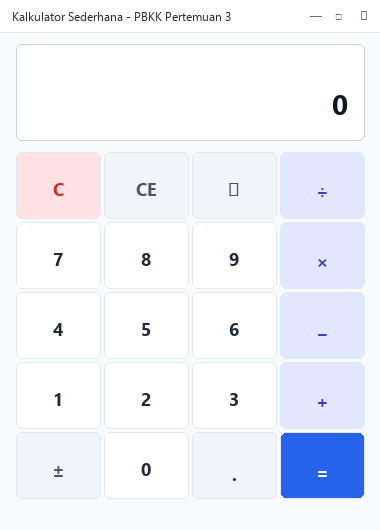
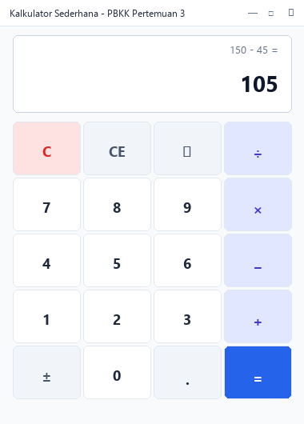
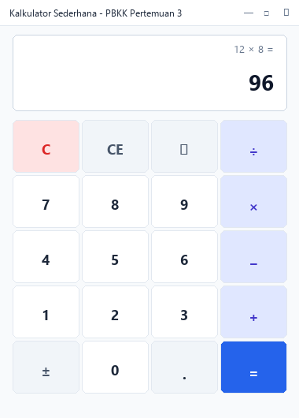
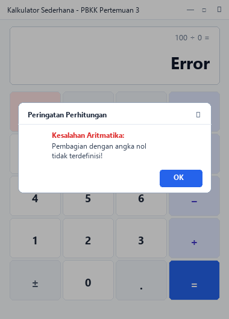
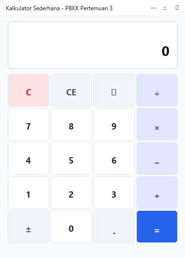
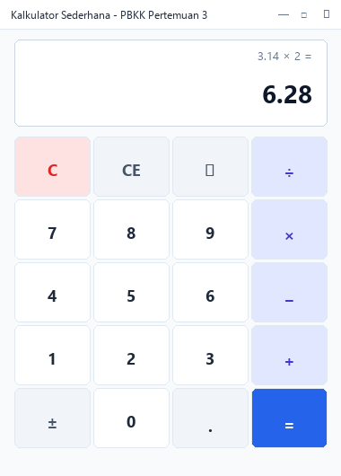

# Pertemuan 3: Latihan 2 - Aplikasi Desktop Kalkulator Sederhana (Windows Forms)

> **Mata Kuliah:** Pemrograman Berbasis Kerangka Kerja (PBKK)  
> **Topik:** Pembuatan Aplikasi Desktop GUI dengan C# Windows Forms (.NET 10) & Error Handling  
> **Framework:** .NET 10.0 (Windows Forms / C#)  

---

## 📋 Deskripsi Praktikum

Praktikum Pertemuan 3 (Latihan 2) berfokus pada pengembangan aplikasi desktop GUI menggunakan kerangka kerja **Windows Forms (WinForms)** di atas **.NET 10.0**. Aplikasi yang dikembangkan adalah **Kalkulator Sederhana (`KalkulatorApp`)** dengan antarmuka yang bersih, responsif, dan kaya fitur interaktif.

Aplikasi mencakup fitur:
1. **Operasi Aritmatika Dasar**: Penjumlahan (`+`), Pengurangan (`−`), Perkalian (`×`), Pembagian (`÷`), dan Modulo (`%`).
2. **Manipulasi Angka & Presisi**: Tombol angka (`0`-`9`), input angka pecahan desimal (`.`), serta fitur pengubah tanda nilai positif/negatif (`±`).
3. **Reset & Koreksi Input**:
   * Tombol **`C`** (*Clear All*): Mengosongkan seluruh operan, operator, dan ekspresi aktif.
   * Tombol **`CE`** (*Clear Entry*): Mengosongkan angka yang sedang diinputkan tanpa menghapus operan sebelumnya.
   * Tombol **`⌫`** (*Backspace*): Menghapus karakter digit terakhir pada layar.
4. **Error Handling & Keamanan Komputasi**:
   * Penanganan pembagian dengan nol (*Division by Zero*) menggunakan blok `try-catch`.
   * Menampilkan dialog pesan peringatan ramah pengguna via `MessageBox.Show` dan status display bertuliskan `Error` guna mencegah *runtime crash*.
5. **Dukungan Keyboard (*Keyboard Shortcuts*)**: Pengguna dapat mengoperasikan kalkulator langsung dari keyboard (tombol angka, `+`, `-`, `*`, `/`, `Enter` untuk samadengan, `Escape` untuk Clear, `Backspace`, dan titik desimal).

---

## 📁 Struktur Direktori

```text
pertemuan-3/
├── Pertemuan3.slnx                 # File Solution .NET
├── KalkulatorApp/                  # Proyek Aplikasi Windows Forms
│   ├── KalkulatorApp.csproj        # Konfigurasi proyek .NET 10 WinForms
│   ├── Program.cs                  # Titik masuk utama aplikasi (Main entry point)
│   ├── MainForm.cs                 # Logika operasi kalkulator, error handling, & event keyboard
│   └── MainForm.Designer.cs        # Definisi visual kontrol & layout form WinForms
├── screenshots/                    # Tangkapan layar bukti eksekusi fitur aplikasi
│   ├── 01_tampilan_awal.png
│   ├── 02_operasi_penjumlahan.png
│   ├── 03_operasi_pengurangan.png
│   ├── 04_operasi_perkalian.png
│   ├── 05_operasi_pembagian.png
│   ├── 06_error_pembagian_nol.png
│   ├── 07_tombol_clear.png
│   └── 08_operasi_desimal.png
└── README.md                       # Laporan & dokumentasi pengerjaan praktikum
```

---

## 🚀 Panduan Menjalankan Program

Pastikan lingkungan Anda telah terpasang [.NET 10 SDK](https://dotnet.microsoft.com/download) pada sistem operasi Windows. Buka terminal (PowerShell / Command Prompt) pada direktori `pertemuan-3/`:

### 1. Kompilasi Solusi
```powershell
dotnet build Pertemuan3.slnx
```

### 2. Menjalankan Aplikasi Kalkulator
```powershell
dotnet run --project KalkulatorApp
```

---

## 🛠️ Rincian Proyek & Penjelasan Kode

### 1. Konfigurasi Proyek (`KalkulatorApp.csproj`)
Proyek dikonfigurasi untuk menargetkan runtime `.NET 10.0-windows` dengan mengaktifkan pustaka Windows Forms:

```xml
<Project Sdk="Microsoft.NET.Sdk">

  <PropertyGroup>
    <OutputType>WinExe</OutputType>
    <TargetFramework>net10.0-windows</TargetFramework>
    <Nullable>enable</Nullable>
    <UseWindowsForms>true</UseWindowsForms>
    <ImplicitUsings>enable</ImplicitUsings>
    <RootNamespace>KalkulatorApp</RootNamespace>
  </PropertyGroup>

</Project>
```

### 2. Penanganan Aritmatika & Error Handling (`MainForm.cs`)
Eksekusi kalkulasi dilakukan dengan validasi pembagian dan modulasi dengan nol. Ketika pembagi bernilai `0`, program secara eksplisit melempar `DivideByZeroException` yang ditangkap pada blok `catch` untuk menampilkan `MessageBox`:

```csharp
private double ExecuteCalculation(double a, double b, string op)
{
    return op switch
    {
        "+" => a + b,
        "-" => a - b,
        "*" => a * b,
        "/" => b == 0
            ? throw new DivideByZeroException("Kesalahan Aritmatika: Pembagian dengan angka nol tidak terdefinisi!")
            : a / b,
        "%" => b == 0
            ? throw new DivideByZeroException("Kesalahan Aritmatika: Modulo dengan angka nol tidak terdefinisi!")
            : a % b,
        _ => b
    };
}

private void HandleError(string message)
{
    _hasError = true;
    txtDisplay.Text = "Error";
    MessageBox.Show(
        message,
        "Peringatan Perhitungan",
        MessageBoxButtons.OK,
        MessageBoxIcon.Warning
    );
}
```

### 3. Dukungan Tombol Keyboard (`ProcessCmdKey`)
Pengguna dapat mengetik secara natural menggunakan tombol fisik keyboard atau numeric keypad:

```csharp
protected override bool ProcessCmdKey(ref Message msg, Keys keyData)
{
    switch (keyData)
    {
        case Keys.D0 or Keys.NumPad0: btn0.PerformClick(); return true;
        case Keys.D1 or Keys.NumPad1: btn1.PerformClick(); return true;
        // ... (digit 2-9)
        case Keys.Oemplus or Keys.Add: btnAdd.PerformClick(); return true;
        case Keys.OemMinus or Keys.Subtract: btnSub.PerformClick(); return true;
        case Keys.Multiply: btnMul.PerformClick(); return true;
        case Keys.Divide: btnDiv.PerformClick(); return true;
        case Keys.Enter: btnEquals.PerformClick(); return true;
        case Keys.Escape: btnClear.PerformClick(); return true;
        case Keys.Back: btnBackspace.PerformClick(); return true;
        case Keys.Decimal or Keys.OemPeriod: btnDot.PerformClick(); return true;
    }
    return base.ProcessCmdKey(ref msg, keyData);
}
```

---

## 🖼️ Template & Slot Peletakan Screenshot

Berikut adalah dokumentasi tangkapan layar bukti eksekusi seluruh fitur pada aplikasi Kalkulator Windows Forms:

### 📸 Slot Screenshot 1: Tampilan Awal Aplikasi
> Lokasi file: `screenshots/01_tampilan_awal.png`


*Gambar 1: Tampilan antarmuka awal saat aplikasi kalkulator pertama kali dijalankan.*

---

### 📸 Slot Screenshot 2: Operasi Penjumlahan (+)
> Lokasi file: `screenshots/02_operasi_penjumlahan.png`


*Gambar 2: Hasil perhitungan penjumlahan dua bilangan (25 + 75 = 100).*

---

### 📸 Slot Screenshot 3: Operasi Pengurangan (−)
> Lokasi file: `screenshots/03_operasi_pengurangan.png`


*Gambar 3: Hasil perhitungan pengurangan dua bilangan (150 − 45 = 105).*

---

### 📸 Slot Screenshot 4: Operasi Perkalian (×)
> Lokasi file: `screenshots/04_operasi_perkalian.png`


*Gambar 4: Hasil perhitungan perkalian dua bilangan (12 × 8 = 96).*

---

### 📸 Slot Screenshot 5: Operasi Pembagian (÷)
> Lokasi file: `screenshots/05_operasi_pembagian.png`


*Gambar 5: Hasil perhitungan pembagian yang menghasilkan bilangan berkoma (100 ÷ 8 = 12.5).*

---

### 📸 Slot Screenshot 6: Error Handling Pembagian dengan Nol
> Lokasi file: `screenshots/06_error_pembagian_nol.png`


*Gambar 6: Penanganan pembagian dengan nol menggunakan try-catch dan dialog peringatan MessageBox.*

---

### 📸 Slot Screenshot 7: Fitur Tombol Clear (C / CE)
> Lokasi file: `screenshots/07_tombol_clear.png`


*Gambar 7: Fitur tombol Clear (C) untuk mereset seluruh kalkulasi kembali ke angka 0.*

---

### 📸 Slot Screenshot 8: Operasi Angka Desimal (.)
> Lokasi file: `screenshots/08_operasi_desimal.png`


*Gambar 8: Perhitungan aritmatika melibatkan pecahan desimal presisi (3.14 × 2 = 6.28).*

---

## 💡 Petunjuk Menambahkan Screenshot Anda Sendiri
1. Jalankan aplikasi melalui terminal dengan perintah: `dotnet run --project KalkulatorApp`.
2. Lakukan pengujian untuk masing-masing operasi perhitungan seperti daftar di atas.
3. Ambil tangkapan layar (*screenshot*) window aplikasi Anda.
4. Simpan gambar dengan nama yang sesuai ke direktori `pertemuan-3/screenshots/`:
   * `01_tampilan_awal.png`
   * `02_operasi_penjumlahan.png`
   * `03_operasi_pengurangan.png`
   * `04_operasi_perkalian.png`
   * `05_operasi_pembagian.png`
   * `06_error_pembagian_nol.png`
   * `07_tombol_clear.png`
   * `08_operasi_desimal.png`
5. Lakukan git commit lokal untuk menyimpan riwayat dokumentasi Anda.
