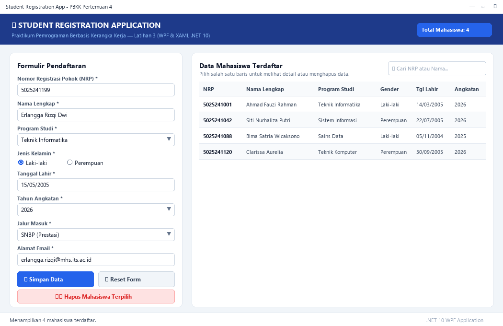
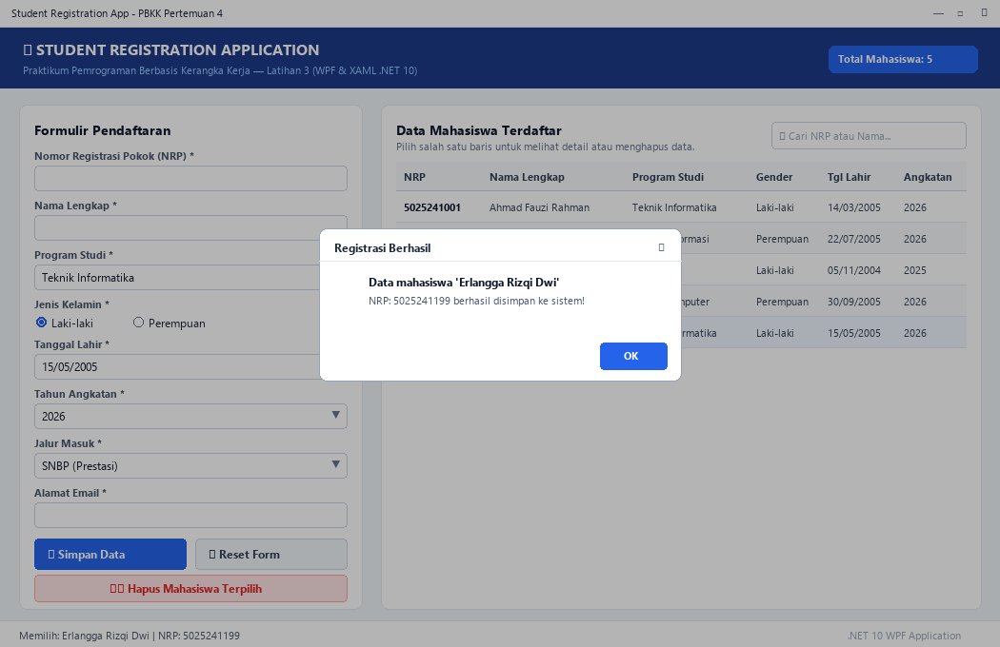
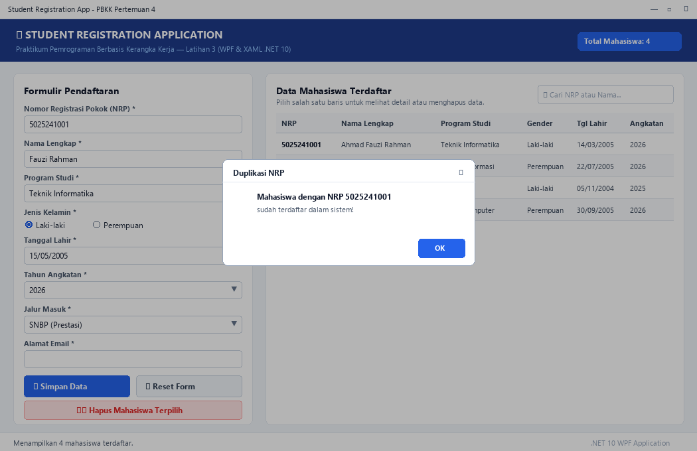
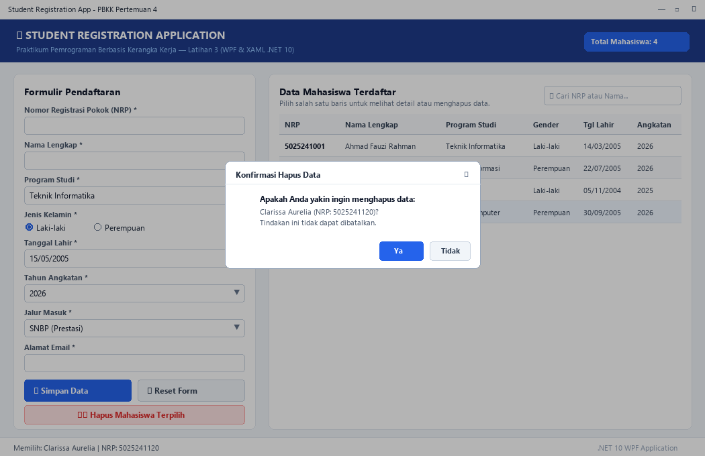
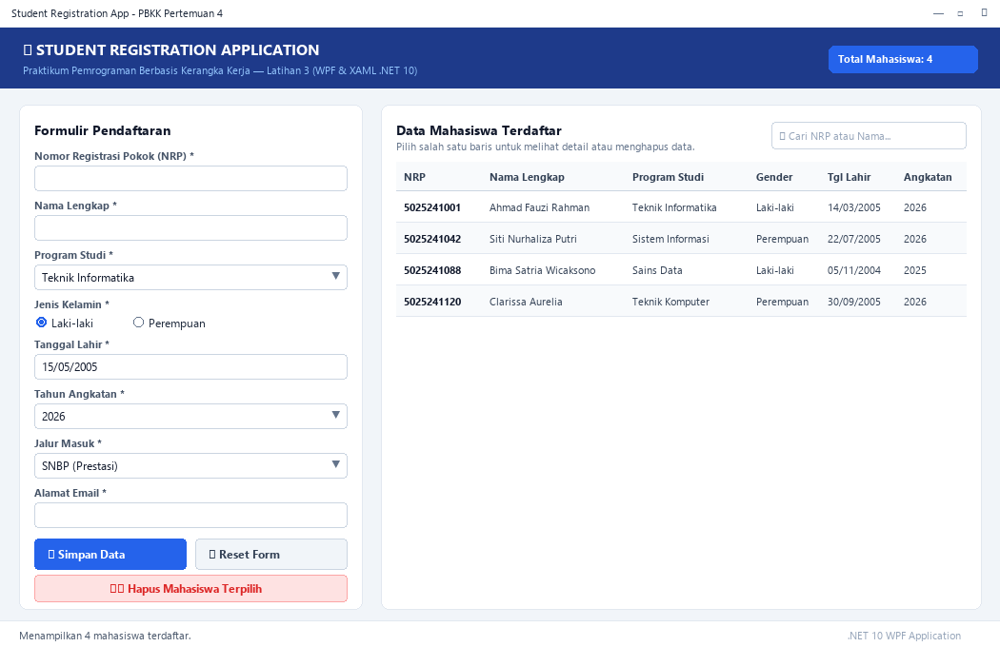

# Pertemuan 4: Latihan 3 - Student Registration App (WPF & XAML)

> **Mata Kuliah:** Pemrograman Berbasis Kerangka Kerja (PBKK)  
> **Topik:** Pembuatan Antarmuka Modern dengan Windows Presentation Foundation (WPF), XAML, dan DataGrid  
> **Framework:** .NET 10.0 (WPF / XAML / C#)  

---

## 📋 Deskripsi Praktikum

Praktikum Pertemuan 4 (Latihan 3) berfokus pada pengenalan dan penerapan teknologi **Windows Presentation Foundation (WPF)** menggunakan bahasa markup **XAML** dan kode logika **C#** di atas **.NET 10.0**. Aplikasi yang dibangun adalah **Student Registration App (`StudentRegistrationApp`)** yang berfungsi sebagai sistem pendaftaran dan pencatatan mahasiswa baru berbasis desktop.

Fitur utama yang diimplementasikan mencakup:
1. **Formulir Pendaftaran Interaktif (XAML)**:
   * **NRP**: Input teks dengan validasi format angka dan panjang karakter.
   * **Nama Lengkap**: Input teks nama mahasiswa.
   * **Program Studi**: Pilihan dropdown (*ComboBox*) mencakup Teknik Informatika, Sistem Informasi, Sains Data, Teknik Komputer, Teknologi Informasi, dan Rekayasa Perangkat Lunak.
   * **Jenis Kelamin**: Komponen pilihan eksklusif (*RadioButton*) Laki-laki / Perempuan.
   * **Tanggal Lahir**: Pemilih kalender grafis (*DatePicker*) dengan validasi tanggal masa lampau.
   * **Tahun Angkatan**: Pilihan tahun angkatan (*ComboBox*).
   * **Jalur Masuk**: Pilihan jalur seleksi (SNBP, SNBT, Mandiri Kemitraan, dsb.).
   * **Email**: Input teks dengan validasi ekspresi reguler (*Regex*).
2. **Penyimpanan Koleksi Dinamis & Data Binding**:
   * Data disimpan dalam memori menggunakan `ObservableCollection<Mahasiswa>` dari pustaka `System.Collections.ObjectModel`.
   * Perubahan koleksi secara otomatis merefleksikan pembaruan pada tabel `DataGrid` tanpa memerlukan refresh manual.
3. **Penyajian Data Berbasis DataGrid**:
   * Tabel mahasiswa dengan kolom terstruktur (*NRP, Nama, Prodi, Gender, Tanggal Lahir, Angkatan, Jalur Masuk, Email*).
   * Fitur seleksi baris (*Single Selection*) untuk melihat detail mahasiswa atau menghapus baris terpilih.
4. **Validasi Input & Error Handling**:
   * Pengecekan field wajib kosong (*Required Fields*).
   * Pengecekan keunikan NRP (*Duplicate Prevention*) agar tidak ada mahasiswa terdaftar ganda.
   * Dialog konfirmasi sebelum penghapusan data untuk mencegah ketidaksengajaan pengguna.
5. **Pencarian Real-Time**:
   * Input pencarian yang secara dinamis menyaring daftar mahasiswa berdasarkan kecocokan NRP, Nama, atau Program Studi.

---

## 📁 Struktur Direktori

```text
pertemuan-4/
├── Pertemuan4.slnx                     # File Solution .NET
├── StudentRegistrationApp/             # Proyek Aplikasi WPF
│   ├── StudentRegistrationApp.csproj   # Konfigurasi proyek .NET 10 WPF
│   ├── App.xaml                        # Definisi resource level aplikasi
│   ├── App.xaml.cs                     # Startup logic aplikasi WPF
│   ├── MainWindow.xaml                 # Desain antarmuka XAML (Form, DataGrid, Header, Status)
│   ├── MainWindow.xaml.cs              # Event handler, validasi data, & manipulasi ObservableCollection
│   └── Models/
│       └── Mahasiswa.cs                # Model data entitas Mahasiswa
├── screenshots/                        # Tangkapan layar bukti eksekusi fitur aplikasi
│   ├── 01_form_pendaftaran_awal.png
│   ├── 02_input_data_valid.png
│   ├── 03_hasil_pendaftaran_datagrid.png
│   ├── 04_validasi_input_kosong.png
│   ├── 05_validasi_nrp_duplikat.png
│   ├── 06_hapus_data_terpilih.png
│   └── 07_reset_form.png
└── README.md                           # Laporan & dokumentasi pengerjaan praktikum
```

---

## 🚀 Panduan Menjalankan Program

Pastikan lingkungan Anda telah terpasang [.NET 10 SDK](https://dotnet.microsoft.com/download) pada sistem operasi Windows. Buka terminal pada direktori `pertemuan-4/`:

### 1. Kompilasi Solusi
```powershell
dotnet build Pertemuan4.slnx
```

### 2. Menjalankan Aplikasi Registrasi
```powershell
dotnet run --project StudentRegistrationApp
```

---

## 🛠️ Rincian Proyek & Penjelasan Kode

### 1. Model Entitas (`Models/Mahasiswa.cs`)
Mendefinisikan atribut mahasiswa lengkap dengan properti pembantu pemformatan tanggal:

```csharp
namespace StudentRegistrationApp.Models
{
    public class Mahasiswa
    {
        public string NRP { get; set; } = string.Empty;
        public string Nama { get; set; } = string.Empty;
        public string Prodi { get; set; } = string.Empty;
        public string JenisKelamin { get; set; } = string.Empty;
        public DateTime TanggalLahir { get; set; }
        public int Angkatan { get; set; }
        public string JalurMasuk { get; set; } = string.Empty;
        public string Email { get; set; } = string.Empty;
        public DateTime TanggalRegistrasi { get; set; } = DateTime.Now;

        public string TanggalLahirFormat => TanggalLahir.ToString("dd/MM/yyyy");
        // ...
    }
}
```

### 2. Antarmuka XAML & DataGrid (`MainWindow.xaml`)
Menggunakan tata letak Grid dua kolom: kolom kiri untuk form input dalam kartu terisolasi, dan kolom kanan untuk visualisasi tabel data:

```xml
<DataGrid x:Name="dgMahasiswa"
          AutoGenerateColumns="False"
          CanUserAddRows="False"
          IsReadOnly="True"
          SelectionMode="Single"
          GridLinesVisibility="Horizontal"
          RowHeight="36">
    <DataGrid.Columns>
        <DataGridTextColumn Header="NRP" Binding="{Binding NRP}" Width="105" FontWeight="SemiBold"/>
        <DataGridTextColumn Header="Nama Lengkap" Binding="{Binding Nama}" Width="160"/>
        <DataGridTextColumn Header="Program Studi" Binding="{Binding Prodi}" Width="145"/>
        <DataGridTextColumn Header="Gender" Binding="{Binding JenisKelamin}" Width="85"/>
        <DataGridTextColumn Header="Tgl Lahir" Binding="{Binding TanggalLahirFormat}" Width="90"/>
        <DataGridTextColumn Header="Angkatan" Binding="{Binding Angkatan}" Width="75"/>
        <DataGridTextColumn Header="Jalur Masuk" Binding="{Binding JalurMasuk}" Width="135"/>
        <DataGridTextColumn Header="Email" Binding="{Binding Email}" Width="*"/>
    </DataGrid.Columns>
</DataGrid>
```

### 3. Logika Validasi & Pendaftaran (`MainWindow.xaml.cs`)
Validasi dilakukan secara menyeluruh sebelum objek ditambahkan ke koleksi:

```csharp
// Pengecekan format NRP
if (!Regex.IsMatch(nrp, @"^\d{9,12}$"))
{
    ShowWarning("Format NRP tidak valid! NRP harus terdiri dari 9 hingga 12 digit angka.", "Validasi Input");
    return;
}

// Pengecekan duplikasi NRP
if (_masterList.Any(m => m.NRP.Equals(nrp, StringComparison.OrdinalIgnoreCase)))
{
    ShowWarning($"Mahasiswa dengan NRP {nrp} sudah terdaftar dalam sistem!", "Duplikasi NRP");
    return;
}

// Tambah ke koleksi dan sinkronisasi tampilan
var baru = new Mahasiswa(nrp, nama, prodi, jenisKelamin, tglLahir.Value, angkatan, jalur, email);
_masterList.Add(baru);
RefreshDataView();
```

---

## 🖼️ Template & Slot Peletakan Screenshot

Berikut adalah dokumentasi tangkapan layar bukti eksekusi seluruh fitur pada aplikasi Student Registration WPF:

### 📸 Slot Screenshot 1: Tampilan Awal Formulir Pendaftaran
> Lokasi file: `screenshots/01_form_pendaftaran_awal.png`


*Gambar 1: Antarmuka aplikasi saat pertama kali dibuka, menampilkan form input dan tabel data awal.*

---

### 📸 Slot Screenshot 2: Pengisian Form dengan Data Valid
> Lokasi file: `screenshots/02_input_data_valid.png`


*Gambar 2: Pengisian form registrasi mahasiswa baru dengan data lengkap dan valid.*

---

### 📸 Slot Screenshot 3: Hasil Pendaftaran Tersimpan di DataGrid
> Lokasi file: `screenshots/03_hasil_pendaftaran_datagrid.png`


*Gambar 3: Data mahasiswa baru berhasil disimpan ke dalam DataGrid disertai dialog konfirmasi sukses.*

---

### 📸 Slot Screenshot 4: Validasi Input Kosong (Required Field)
> Lokasi file: `screenshots/04_validasi_input_kosong.png`


*Gambar 4: Dialog peringatan sistem saat pengguna mencoba menyimpan form dengan field wajib yang kosong.*

---

### 📸 Slot Screenshot 5: Validasi Pencegahan NRP Duplikat
> Lokasi file: `screenshots/05_validasi_nrp_duplikat.png`


*Gambar 5: Sistem mendeteksi dan menolak pendaftaran mahasiswa dengan NRP yang sudah ada di database.*

---

### 📸 Slot Screenshot 6: Konfirmasi dan Penghapusan Data Mahasiswa
> Lokasi file: `screenshots/06_hapus_data_terpilih.png`


*Gambar 6: Dialog konfirmasi penghapusan data mahasiswa yang sedang dipilih pada DataGrid.*

---

### 📸 Slot Screenshot 7: Fitur Reset Form Input
> Lokasi file: `screenshots/07_reset_form.png`


*Gambar 7: Fitur pengosongan formulir kembali ke kondisi awal setelah tombol Reset ditekan.*

---

## 💡 Petunjuk Menambahkan Screenshot Anda Sendiri
1. Jalankan aplikasi melalui terminal dengan perintah: `dotnet run --project StudentRegistrationApp`.
2. Lakukan pengujian pendaftaran, validasi, dan manipulasi data mahasiswa.
3. Ambil tangkapan layar (*screenshot*) window aplikasi Anda.
4. Simpan gambar dengan nama file yang sesuai ke direktori `pertemuan-4/screenshots/`:
   * `01_form_pendaftaran_awal.png`
   * `02_input_data_valid.png`
   * `03_hasil_pendaftaran_datagrid.png`
   * `04_validasi_input_kosong.png`
   * `05_validasi_nrp_duplikat.png`
   * `06_hapus_data_terpilih.png`
   * `07_reset_form.png`
5. Lakukan git commit lokal untuk menyimpan riwayat dokumentasi Anda.
