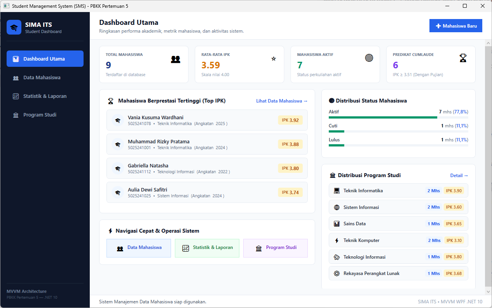
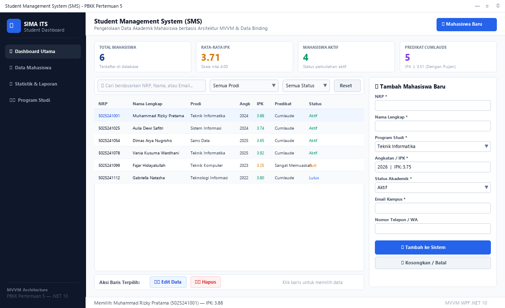
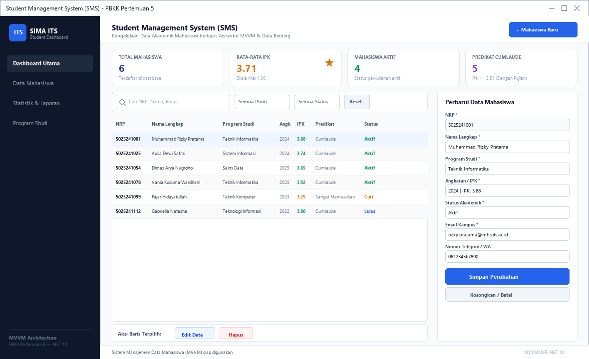
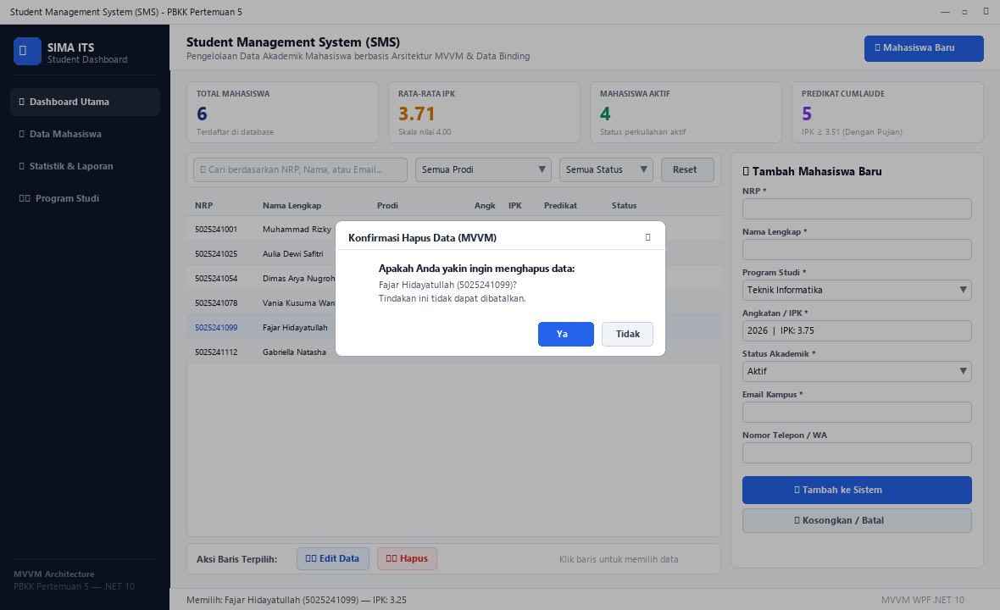
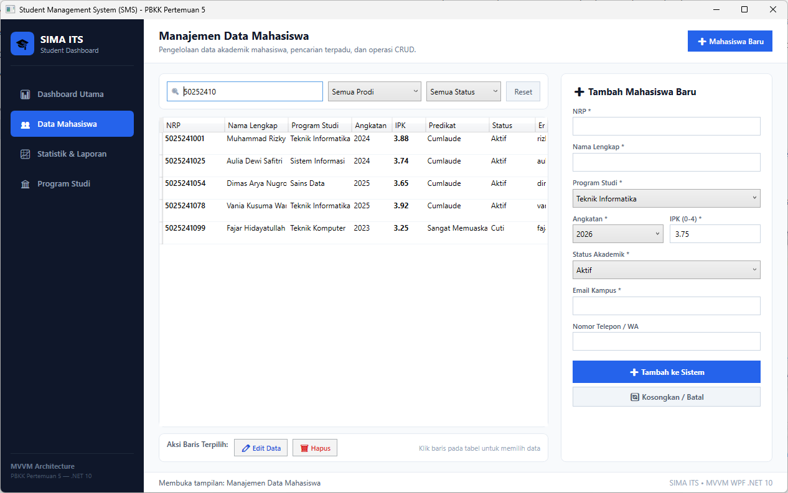
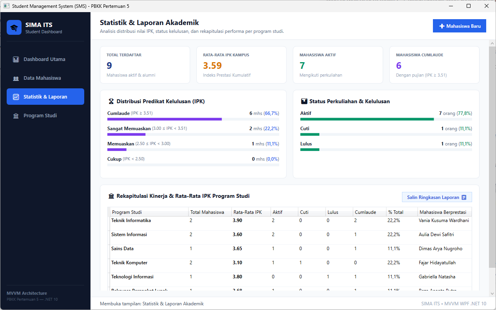

# Pertemuan 5: Latihan 4 - Student Management System (SMS) dengan Arsitektur MVVM

> **Mata Kuliah:** Pemrograman Berbasis Kerangka Kerja (PBKK)  
> **Topik:** Desain Antarmuka Modern Rich UI & Penerapan Pola Arsitektur MVVM (*Model-View-ViewModel*) pada WPF  
> **Framework:** .NET 10.0 (WPF / XAML / MVVM / C#)  

---

## 📋 Deskripsi Praktikum

Praktikum Pertemuan 5 (Latihan 4) berfokus pada implementasi arsitektur perangkat lunak modern **Model-View-ViewModel (MVVM)** menggunakan teknologi **WPF (.NET 10.0)**. Aplikasi yang dikembangkan adalah **Student Management System (SMS) / Student Dashboard (`StudentManagementSystem`)** yang menyediakan pengelolaan data akademik mahasiswa secara komprehensif, terstruktur, dan reaktif.

Pola arsitektur **MVVM** memisahkan kode antarmuka (*UI Presentation*) secara murni dari logika bisnis (*Business Logic*) dan manipulasi model data:
* **Model (`Models/Student.cs`)**: Merepresentasikan struktur data entitas mahasiswa, atribut, validasi predikat, serta pemformatan nilai IPK.
* **ViewModel (`ViewModels/MainViewModel.cs`)**: Mengelola *state* aplikasi, mengeksekusi operasi perintah (*Commands*), mengkalkulasi metrik statistik dashboard secara reaktif, serta menyediakan properti yang terikat dua arah (*Two-Way Binding*) ke View.
* **View (`Views/MainWindow.xaml`)**: Menyajikan antarmuka visual modern berbasis *Rich UI* yang hanya berkomunikasi dengan ViewModel melalui mekanisme XAML Data Binding tanpa penulisan logika bisnis di file *code-behind*.

Fitur utama yang dihadirkan meliputi:
1. **Navigasi Multi-View Interaktif (Sidebar Navigation)**:
   * **📊 Dashboard Utama**: Ringkasan KPI akademik, daftar mahasiswa berprestasi tertinggi (*Top IPK*), distribusi status perkuliahan, dan shortcut navigasi cepat.
   * **👥 Data Mahasiswa**: Ruang kerja manajemen data lengkap dengan tabel DataGrid, pencarian real-time, multi-filter (Prodi & Status), dan formulir CRUD dua arah (*Two-Way Data Binding*).
   * **📈 Statistik & Laporan**: Visualisasi analitik distribusi predikat kelulusan (*Cumlaude*, Sangat Memuaskan, Memuaskan, Cukup) dengan indikator *progress bar*, tabel rekapitulasi kinerja prodi, dan tombol ekspor salin laporan akademik ke *clipboard*.
   * **🏛️ Program Studi**: Direktori profil program studi interaktif dengan kartu metrik per departemen dan daftar mahasiswa khusus pada prodi terpilih.
2. **Dashboard Statistik Dinamis (KPI Cards)**:
   * **Total Mahasiswa**: Jumlah total mahasiswa terdaftar.
   * **Rata-Rata IPK**: Kalkulasi rata-rata indeks prestasi kumulatif mahasiswa skala 4.00.
   * **Mahasiswa Aktif**: Penghitungan jumlah mahasiswa dengan status akademik aktif.
   * **Predikat Cumlaude**: Jumlah mahasiswa yang memiliki IPK $\ge 3.51$.
3. **Operasi Lengkap CRUD (*Create, Read, Update, Delete*)**:
   * **Create**: Menambah mahasiswa baru dengan validasi format angka, keunikan NRP, dan batas IPK.
   * **Read**: Menampilkan seluruh data mahasiswa pada tabel DataGrid dengan visualisasi status badge dan predikat.
   * **Update**: Memilih data mahasiswa dari tabel untuk dimuat otomatis ke formulir dalam mode pengeditan, lalu menyimpan pembaruan.
   * **Delete**: Menghapus data mahasiswa dari sistem dengan dialog konfirmasi keamanan.
4. **Pencarian & Penyaringan Real-Time**:
   * Filter teks berdasarkan kata kunci Nama, NRP, atau Email.
   * Filter bertingkat berdasarkan dropdown Program Studi dan Status Akademik (Aktif, Cuti, Lulus).

---

## 📁 Struktur Direktori

```text
pertemuan-5/
├── Pertemuan5.slnx                         # File Solution .NET
├── StudentManagementSystem/                # Proyek Aplikasi WPF MVVM
│   ├── StudentManagementSystem.csproj      # Konfigurasi proyek .NET 10 WPF
│   ├── App.xaml                            # Deklarasi startup aplikasi
│   ├── App.xaml.cs                         # Kode bootstrap aplikasi WPF
│   ├── Models/
│   │   ├── Student.cs                      # Model entitas Mahasiswa (turunan ViewModelBase)
│   │   └── StatisticsModels.cs             # Model statistik Prodi, Predikat, & Status
│   ├── ViewModels/
│   │   ├── ViewModelBase.cs                # Kelas basis pengimplementasi INotifyPropertyChanged
│   │   ├── RelayCommand.cs                 # Implementasi antarmuka ICommand untuk aksi tombol
│   │   └── MainViewModel.cs                # State manager, navigasi multi-view, CRUD, & statistik
│   └── Views/
│       ├── MainWindow.xaml                 # Desain antarmuka XAML multi-view (MVVM)
│       └── MainWindow.xaml.cs              # Code-behind minimalis (hanya inisialisasi DataContext)
├── screenshots/                            # Tangkapan layar bukti eksekusi fitur aplikasi
│   ├── 01_dashboard_utama.png
│   ├── 02_daftar_mahasiswa_datagrid.png
│   ├── 03_tambah_mahasiswa_mvvm.png
│   ├── 04_edit_mahasiswa_mvvm.png
│   ├── 05_hapus_mahasiswa_mvvm.png
│   ├── 06_pencarian_filter_mahasiswa.png
│   ├── 07_statistik_ringkasan_data.png
│   ├── 08_statistik_laporan_view.png
│   └── 09_program_studi_view.png
└── README.md                               # Laporan & dokumentasi pengerjaan praktikum
```

---

## 🚀 Panduan Menjalankan Program

Pastikan lingkungan Anda telah terpasang [.NET 10 SDK](https://dotnet.microsoft.com/download) pada sistem operasi Windows. Buka terminal pada direktori `pertemuan-5/`:

### 1. Kompilasi Solusi
```powershell
dotnet build Pertemuan5.slnx
```

### 2. Menjalankan Aplikasi Student Management System
```powershell
dotnet run --project StudentManagementSystem
```

---

## 🛠️ Rincian Proyek & Penjelasan Kode

### 1. Kelas Fondasi MVVM (`ViewModelBase.cs` & `RelayCommand.cs`)
`ViewModelBase` mengimplementasikan `INotifyPropertyChanged` menggunakan atribut `[CallerMemberName]` agar pembaruan data otomatis diteruskan ke View:

```csharp
public abstract class ViewModelBase : INotifyPropertyChanged
{
    public event PropertyChangedEventHandler? PropertyChanged;

    protected bool SetProperty<T>(ref T storage, T value, [CallerMemberName] string? propertyName = null)
    {
        if (EqualityComparer<T>.Default.Equals(storage, value)) return false;
        storage = value;
        PropertyChanged?.Invoke(this, new PropertyChangedEventArgs(propertyName));
        return true;
    }
}
```

`RelayCommand` mengkapsulasi eksekusi *delegate* aksi dan pengecekan kelayakan (*canExecute*) pada `ICommand`:

```csharp
public class RelayCommand : ICommand
{
    private readonly Action<object?> _execute;
    private readonly Predicate<object?>? _canExecute;

    public RelayCommand(Action execute) : this(_ => execute(), null) { }
    public bool CanExecute(object? parameter) => _canExecute == null || _canExecute(parameter);
    public void Execute(object? parameter) => _execute(parameter);
}
```

### 2. ViewModel Terpadu (`MainViewModel.cs`)
Seluruh status aplikasi dan eksekusi CRUD dikendalikan pada `MainViewModel`:

```csharp
// Perintah Simpan (Create / Update)
public ICommand SaveCommand { get; }
// Perintah Edit Baris Terpilih
public ICommand EditCommand { get; }
// Perintah Hapus Baris Terpilih
public ICommand DeleteCommand { get; }

private void ExecuteSave()
{
    if (IsEditMode)
    {
        // Logika UPDATE
        var existing = _masterStudents.First(s => s.NRP == FormNRP);
        existing.Nama = FormNama;
        existing.IPK = double.Parse(FormIPK, CultureInfo.InvariantCulture);
        // ...
    }
    else
    {
        // Logika CREATE
        var newStudent = new Student(FormNRP, FormNama, FormProdi, FormAngkatan, ipk, FormStatus, FormEmail, FormTelepon);
        _masterStudents.Add(newStudent);
    }
    ApplyFilter();
    UpdateDashboardMetrics();
}
```

### 3. Pemisahan Total pada View (`Views/MainWindow.xaml`)
Pada View tidak terdapat *event handler* tombol (`Click=""`). Semua interaksi terikat langsung ke properti dan *Command* di ViewModel:

```xml
<!-- Binding Kartu Statistik -->
<TextBlock Text="{Binding TotalStudents}" FontSize="24" FontWeight="Bold"/>

<!-- Binding Kolom Pencarian Real-Time -->
<TextBox Text="{Binding SearchKeyword, UpdateSourceTrigger=PropertyChanged}"/>

<!-- Binding Eksekusi Perintah CRUD -->
<Button Content="💾 Simpan" Command="{Binding SaveCommand}"/>
<Button Content="✏️ Edit" Command="{Binding EditCommand}"/>
<Button Content="🗑️ Hapus" Command="{Binding DeleteCommand}"/>
```

---

## 🖼️ Template & Slot Peletakan Screenshot

Berikut adalah dokumentasi tangkapan layar bukti eksekusi seluruh fitur pada aplikasi Student Management System WPF (MVVM):

### 📸 Slot Screenshot 1: Tampilan Dashboard Utama
> Lokasi file: `screenshots/01_dashboard_utama.png`


*Gambar 1: Tampilan dashboard utama dengan navigasi sidebar, 4 kartu metrik statistik, dan tabel data mahasiswa.*

---

### 📸 Slot Screenshot 2: Daftar Mahasiswa pada DataGrid
> Lokasi file: `screenshots/02_daftar_mahasiswa_datagrid.png`


*Gambar 2: Visualisasi tabel data mahasiswa lengkap dengan kolom predikat kelulusan dan badge status akademik.*

---

### 📸 Slot Screenshot 3: Penambahan Mahasiswa Baru via MVVM
> Lokasi file: `screenshots/03_tambah_mahasiswa_mvvm.png`


*Gambar 3: Form penambahan mahasiswa baru terikat data binding dan dialog sukses penambahan data.*

---

### 📸 Slot Screenshot 4: Mode Pengeditan Data Mahasiswa (Update)
> Lokasi file: `screenshots/04_edit_mahasiswa_mvvm.png`


*Gambar 4: Fitur edit data via EditCommand, memuat atribut baris terpilih ke dalam formulir secara otomatis.*

---

### 📸 Slot Screenshot 5: Konfirmasi Penghapusan Data Mahasiswa (Delete)
> Lokasi file: `screenshots/05_hapus_mahasiswa_mvvm.png`


*Gambar 5: Dialog konfirmasi penghapusan data mahasiswa terpilih yang dieksekusi via DeleteCommand.*

---

### 📸 Slot Screenshot 6: Pencarian Real-Time & Filter Program Studi
> Lokasi file: `screenshots/06_pencarian_filter_mahasiswa.png`


*Gambar 6: Penyaringan data secara instan berdasarkan kata kunci dan dropdown filter program studi.*

---

### 📸 Slot Screenshot 7: Pembaruan Statistik Dashboard Dinamis
> Lokasi file: `screenshots/07_statistik_ringkasan_data.png`


*Gambar 7: Metrik ringkasan data (Total, Rata-rata IPK, Mahasiswa Aktif, Cumlaude) yang otomatis terkalkulasi secara reaktif.*

---

### 📸 Slot Screenshot 8: Tampilan Modul Statistik & Laporan Akademik
> Lokasi file: `screenshots/08_statistik_laporan_view.png`


*Gambar 8: Tampilan lengkap modul Statistik & Laporan dengan visualisasi progress bar distribusi IPK/predikat, status perkuliahan, tabel rekapitulasi performa per prodi, dan tombol ekspor clipboard.*

---

### 📸 Slot Screenshot 9: Tampilan Modul Program Studi & Direktori Mahasiswa
> Lokasi file: `screenshots/09_program_studi_view.png`


*Gambar 9: Tampilan direktori Program Studi interaktif yang menyajikan kartu metrik per departemen dan tabel rincian mahasiswa pada program studi yang dipilih.*

---

## 💡 Petunjuk Menambahkan Screenshot Anda Sendiri
1. Jalankan aplikasi melalui terminal dengan perintah: `dotnet run --project StudentManagementSystem`.
2. Lakukan pengujian dashboard, manipulasi CRUD data, pencarian, dan pemfilteran program studi.
3. Ambil tangkapan layar (*screenshot*) window aplikasi Anda.
4. Simpan gambar dengan nama yang sesuai ke direktori `pertemuan-5/screenshots/`:
   * `01_dashboard_utama.png`
   * `02_daftar_mahasiswa_datagrid.png`
   * `03_tambah_mahasiswa_mvvm.png`
   * `04_edit_mahasiswa_mvvm.png`
   * `05_hapus_mahasiswa_mvvm.png`
   * `06_pencarian_filter_mahasiswa.png`
   * `07_statistik_ringkasan_data.png`
   * `08_statistik_laporan_view.png`
   * `09_program_studi_view.png`
5. Lakukan git commit lokal untuk menyimpan riwayat dokumentasi Anda.
