# Pertemuan 6: Integrasi Database SQL Server & ADO.NET pada Aplikasi Desktop WPF

> **Mata Kuliah:** Pemrograman Berbasis Kerangka Kerja (PBKK) — Kelas C  
> **Topik:** Membangun Basis Data Relasional SQL Server & Integrasi Desktop WPF menggunakan ADO.NET  
> **Framework & Teknologi:** .NET 10.0 (C# / WPF / XAML), ADO.NET (`Microsoft.Data.SqlClient`), SQL Server / LocalDB  
> **Praktikan:** Erlangga Rizqi Dwi Raswanto (NRP: 5025241179)  

---

## 📋 Deskripsi Praktikum

Praktikum Pertemuan 6 berfokus pada penguasaan integrasi basis data relasional enterprise menggunakan teknologi **SQL Server** dan pustaka akses data tingkat rendah berkinerja tinggi **ADO.NET (`Microsoft.Data.SqlClient`)** pada aplikasi desktop **Windows Presentation Foundation (WPF)**. Praktikum ini memadukan dua modul utama (*Hands-On Lab*):

1. **Hands-On Lab 1 (HOL 1) — Membangun Basis Data Relasional SQL Server:**
   * Konfigurasi koneksi ke instans SQL Server (LocalDB / Express / Developer Edition).
   * Pembuatan basis data `StudentRegistrationDB` menggunakan skrip SQL DDL (*Data Definition Language*).
   * Perancangan skema relasional dua tabel, yaitu tabel induk `Programs` (Program Studi) dan tabel anak `Students` (Mahasiswa) dengan relasi **One-to-Many (1:N)**.
   * Penerapan integritas data melalui *Primary Key*, *Foreign Key*, *Unique Constraint* pada NIM, serta *Check Constraint* pada nilai IPK/GPA.
   * Pengujian integritas basis data (*Foreign Key Violation* dan *Duplicate Key Violation*) serta eksekusi query analitik relasional (`INNER JOIN`, `LEFT JOIN`, `GROUP BY`, dan agregasi).

2. **Hands-On Lab 2 (HOL 2) — Integrasi Desktop WPF Terhubung SQL Server via ADO.NET:**
   * Pengembangan aplikasi desktop modern berbasis arsitektur **Repository Pattern** dan **Model-View-ViewModel (MVVM)**.
   * Akses data langsung menggunakan komponen inti ADO.NET: `SqlConnection`, `SqlCommand`, `SqlDataReader`, dan `SqlParameter`.
   * Pencegahan kerentanan keamanan *SQL Injection* secara ketat melalui implementasi *Parameterized Queries*.
   * Implementasi operasi data komprehensif **CRUD (*Create, Read, Update, Delete*)** yang tersinkronisasi langsung ke SQL Server secara transaksional.
   * Fitur pencarian real-time, penyaringan bertingkat (*Multi-Filter* berdasarkan Program Studi dan Status Akademik), kartu metrik statistik dinamis, serta mekanisme *self-healing / auto-provisioning* database.

---

## 📁 Struktur Direktori Proyek

```text
pertemuan-6/
├── Pertemuan6.slnx                         # Solution .NET Visual Studio
├── Database/                               # Skrip Basis Data SQL Server (HOL 1)
│   ├── StudentRegistrationDB.sql           # DDL, DML, Constraints, Seed Data, Uji Integritas
│   └── Query-Challenges.sql                # 5 Query Tantangan Analitik (JOIN, GROUP BY, Filter)
├── StudentRegistration/                    # Proyek Aplikasi Desktop WPF ADO.NET (HOL 2)
│   ├── StudentRegistration.csproj          # Konfigurasi proyek .NET 10 WPF & Microsoft.Data.SqlClient
│   ├── App.xaml / App.xaml.cs              # Entry point aplikasi WPF
│   ├── Config/
│   │   └── DatabaseConfig.cs               # Manajemen Connection String (LocalDB / SQLEXPRESS)
│   ├── Models/
│   │   ├── ProgramStudy.cs                 # Model entitas tabel Programs
│   │   └── Student.cs                      # Model entitas tabel Students (INotifyPropertyChanged)
│   ├── Repositories/
│   │   ├── IStudentRepository.cs           # Kontrak antarmuka akses data ADO.NET
│   │   └── StudentRepository.cs            # Implementasi murni SqlConnection, SqlCommand, SqlDataReader
│   ├── ViewModels/
│   │   ├── ViewModelBase.cs                # Kelas basis notifikasi properti MVVM
│   │   ├── RelayCommand.cs                 # Implementasi ICommand untuk aksi tombol UI
│   │   └── MainViewModel.cs                # State manager, logika CRUD, filter pencarian, & KPI
│   └── Views/
│       ├── MainWindow.xaml                 # Desain antarmuka modern Rich UI WPF
│       └── MainWindow.xaml.cs              # Code-behind minimalis (inisialisasi DataContext)
├── screenshots/                            # Dokumentasi visual bukti eksekusi fitur
│   ├── 01_sql_server_connection.png
│   ├── 02_create_database_studentregistrationdb.png
│   ├── 03_table_programs_data.png
│   ├── 04_table_students_data.png
│   ├── 05_inner_join_query_result.png
│   ├── 06_foreign_key_integrity_test.png
│   ├── 07_unique_constraint_test.png
│   ├── 08_wpf_app_main_dashboard.png
│   ├── 09_wpf_app_add_student.png
│   ├── 10_wpf_app_edit_student.png
│   ├── 11_wpf_app_delete_student.png
│   └── 12_wpf_app_filter_and_search.png
└── README.md                               # Laporan & dokumentasi komprehensif praktikum
```

---

## 🗄️ Desain Basis Data (Hands-On Lab 1)

### 1. Diagram Relasi Entitas (ERD: 1 to Many)

```text
┌───────────────────────────────┐                 ┌───────────────────────────────┐
│           Programs            │                 │           Students            │
├───────────────────────────────┤                 ├───────────────────────────────┤
│ PK  ProgramId   INT (IDENTITY)│ 1             N │ PK  StudentId   INT (IDENTITY)│
│ UQ  ProgramCode VARCHAR(20)   │───[1 to N]─────<│ UQ  NIM         VARCHAR(20)   │
│     ProgramName VARCHAR(100)  │                 │     Name        VARCHAR(100)  │
│     IsActive    BIT           │                 │ FK  ProgramId   INT           │
│     CreatedAt   DATETIME2     │                 │     BirthDate   DATE          │
└───────────────────────────────┘                 │     Address     NVARCHAR(255) │
                                                  │     PhoneNumber VARCHAR(20)   │
                                                  │     Email       VARCHAR(100)  │
                                                  │     GPA         DECIMAL(3,2)  │
                                                  │     IsActive    BIT           │
                                                  │     CreatedAt   DATETIME2     │
                                                  └───────────────────────────────┘
```

* **Relasi One-to-Many (1:N):** Satu baris program studi pada tabel `Programs` dapat menaungi banyak mahasiswa pada tabel `Students`. Sebaliknya, setiap mahasiswa hanya dapat terdaftar pada tepat satu `ProgramId`.

---

### 2. Kamus Data (*Data Dictionary*)

#### A. Tabel `Programs` (Tabel Induk / Parent)
| Nama Kolom | Tipe Data | Nullable | Keterangan & Batasan Integritas |
| :--- | :--- | :---: | :--- |
| `ProgramId` | `INT` | NO | **Primary Key**, auto-increment `IDENTITY(1,1)`. |
| `ProgramCode`| `VARCHAR(20)` | NO | **Unique Constraint** (`UQ_Programs_ProgramCode`), contoh: `TI`, `SI`, `SD`. |
| `ProgramName`| `VARCHAR(100)`| NO | Nama resmi program studi. |
| `IsActive` | `BIT` | NO | Status keaktifan prodi, default `1` (Aktif). |
| `CreatedAt` | `DATETIME2` | NO | Waktu pencatatan record, default `SYSDATETIME()`. |

#### B. Tabel `Students` (Tabel Anak / Child)
| Nama Kolom | Tipe Data | Nullable | Keterangan & Batasan Integritas |
| :--- | :--- | :---: | :--- |
| `StudentId` | `INT` | NO | **Primary Key**, auto-increment `IDENTITY(1,1)`. |
| `NIM` | `VARCHAR(20)` | NO | **Unique Constraint** (`UQ_Students_NIM`), nomor induk mahasiswa. |
| `Name` | `VARCHAR(100)`| NO | Nama lengkap mahasiswa. |
| `ProgramId` | `INT` | NO | **Foreign Key** (`FK_Students_Programs`) mereferensikan `Programs(ProgramId)`. |
| `BirthDate` | `DATE` | YES | Tanggal lahir mahasiswa. |
| `Address` | `NVARCHAR(255)`| YES | Alamat domisili lengkap mahasiswa. |
| `PhoneNumber`| `VARCHAR(20)` | YES | Nomor telepon seluler atau WhatsApp. |
| `Email` | `VARCHAR(100)`| YES | Alamat email resmi kampus / pribadi. |
| `GPA` | `DECIMAL(3,2)`| YES | Indeks Prestasi Kumulatif, validasi `CHECK (GPA >= 0.00 AND GPA <= 4.00)`. |
| `IsActive` | `BIT` | NO | Status keaktifan akademik mahasiswa, default `1` (Aktif). |
| `CreatedAt` | `DATETIME2` | NO | Waktu pendaftaran pertama kali, default `SYSDATETIME()`. |

---

### 3. Skrip SQL Utama (`Database/StudentRegistrationDB.sql`)

Potongan skrip pembuatan tabel dan *Foreign Key* dengan penanganan error terstruktur:

```sql
-- Pembuatan Tabel Induk: Programs
CREATE TABLE dbo.Programs
(
    ProgramId   INT IDENTITY(1,1) NOT NULL,
    ProgramCode VARCHAR(20)       NOT NULL,
    ProgramName VARCHAR(100)      NOT NULL,
    IsActive    BIT               NOT NULL CONSTRAINT DF_Programs_IsActive DEFAULT (1),
    CreatedAt   DATETIME2         NOT NULL CONSTRAINT DF_Programs_CreatedAt DEFAULT (SYSDATETIME()),

    CONSTRAINT PK_Programs PRIMARY KEY CLUSTERED (ProgramId),
    CONSTRAINT UQ_Programs_ProgramCode UNIQUE NONCLUSTERED (ProgramCode)
);

-- Pembuatan Tabel Anak: Students
CREATE TABLE dbo.Students
(
    StudentId   INT IDENTITY(1,1) NOT NULL,
    NIM         VARCHAR(20)       NOT NULL,
    Name        VARCHAR(100)      NOT NULL,
    ProgramId   INT               NOT NULL,
    BirthDate   DATE              NULL,
    Address     NVARCHAR(255)     NULL,
    PhoneNumber VARCHAR(20)       NULL,
    Email       VARCHAR(100)      NULL,
    GPA         DECIMAL(3,2)      NULL,
    IsActive    BIT               NOT NULL CONSTRAINT DF_Students_IsActive DEFAULT (1),
    CreatedAt   DATETIME2         NOT NULL CONSTRAINT DF_Students_CreatedAt DEFAULT (SYSDATETIME()),

    CONSTRAINT PK_Students PRIMARY KEY CLUSTERED (StudentId),
    CONSTRAINT UQ_Students_NIM UNIQUE NONCLUSTERED (NIM),
    CONSTRAINT FK_Students_Programs FOREIGN KEY (ProgramId)
        REFERENCES dbo.Programs (ProgramId)
        ON UPDATE CASCADE
        ON DELETE NO ACTION,
    CONSTRAINT CK_Students_GPA CHECK (GPA >= 0.00 AND GPA <= 4.00)
);
```

---

### 4. Query Tantangan & Analisis Data (`Database/Query-Challenges.sql`)

Skrip ini menguji kemampuan analitik relasional SQL:
1. **Challenge 1 (INNER JOIN):** Menggabungkan data mahasiswa dengan nama program studi secara spesifik.
2. **Challenge 2 (LEFT JOIN & GROUP BY):** Rekapitulasi jumlah mahasiswa, rata-rata IPK, dan jumlah mahasiswa aktif per departemen (memastikan prodi yang belum memiliki mahasiswa tetap tampil dengan nilai 0).
3. **Challenge 3 (Filtering & Ordering):** Menyaring mahasiswa berprestasi (*Cumlaude* dengan IPK $\ge 3.51$) diurutkan dari nilai tertinggi.
4. **Challenge 4 (Distribusi Predikat Akademik):** Menghitung persentase mahasiswa berdasarkan predikat kelulusan ITS (Cumlaude, Sangat Memuaskan, Memuaskan, Cukup).
5. **Challenge 5 (Simulasi Parameterized Search):** Pengujian logika query dinamis berbasis parameter `@Keyword` dan `@ProgramId`.

---

## 💻 Integrasi ADO.NET pada Aplikasi WPF (Hands-On Lab 2)

### 1. Arsitektur Alur Data (*Data Flow Pipeline*)

```text
┌────────────────────────────────────────────────────────┐
│               WPF View (MainWindow.xaml)              │
│       DataGrid, Form Input, KPI Metric Cards           │
└───────────────────────────▲────────────────────────────┘
                            │ Data Binding (Two-Way & Commands)
┌───────────────────────────▼────────────────────────────┐
│            MainViewModel (MainViewModel.cs)            │
│   Manajemen State UI, Validasi Input, Kalkulasi Metrik │
└───────────────────────────▲────────────────────────────┘
                            │ Invocations
┌───────────────────────────▼────────────────────────────┐
│         StudentRepository (StudentRepository.cs)       │
│    Pemetaan Relasional ke Object C# (Data Access Layer)│
└───────────────────────────▲────────────────────────────┘
                            │ ADO.NET Calls
┌───────────────────────────▼────────────────────────────┐
│          Microsoft.Data.SqlClient (ADO.NET)            │
│ SqlConnection ──▶ SqlCommand (Parameterized) ──▶ SqlDataReader
└───────────────────────────▲────────────────────────────┘
                            │ TCP / Named Pipes Protocol
┌───────────────────────────▼────────────────────────────┐
│              SQL Server / LocalDB Database             │
│                 StudentRegistrationDB                  │
└────────────────────────────────────────────────────────┘
```

---

### 2. Implementasi Operasi CRUD dengan ADO.NET Murni

#### A. Operasi READ (SELECT dengan INNER JOIN & Parameterized Filter)
```csharp
public List<Student> GetAll(string? keyword = null, int? programId = null, bool? isActive = null)
{
    var students = new List<Student>();
    const string query = @"
        SELECT 
            s.StudentId, s.NIM, s.Name, s.ProgramId, p.ProgramCode, p.ProgramName,
            s.BirthDate, s.Address, s.PhoneNumber, s.Email, s.GPA, s.IsActive, s.CreatedAt
        FROM dbo.Students s
        INNER JOIN dbo.Programs p ON s.ProgramId = p.ProgramId
        WHERE (@Keyword IS NULL OR @Keyword = '' OR s.NIM LIKE @SearchPattern OR s.Name LIKE @SearchPattern OR s.Email LIKE @SearchPattern)
          AND (@ProgramId IS NULL OR @ProgramId = 0 OR s.ProgramId = @ProgramId)
          AND (@IsActive IS NULL OR s.IsActive = @IsActive)
        ORDER BY s.StudentId DESC;";

    using var connection = new SqlConnection(_connectionString);
    using var command = new SqlCommand(query, connection);

    string searchPattern = string.IsNullOrWhiteSpace(keyword) ? string.Empty : $"%{keyword.Trim()}%";
    command.Parameters.Add("@Keyword", SqlDbType.NVarChar, 100).Value = (object?)keyword?.Trim() ?? DBNull.Value;
    command.Parameters.Add("@SearchPattern", SqlDbType.NVarChar, 100).Value = string.IsNullOrWhiteSpace(searchPattern) ? (object)DBNull.Value : searchPattern;
    command.Parameters.Add("@ProgramId", SqlDbType.Int).Value = (object?)programId ?? DBNull.Value;
    command.Parameters.Add("@IsActive", SqlDbType.Bit).Value = (object?)isActive ?? DBNull.Value;

    connection.Open();
    using var reader = command.ExecuteReader();
    while (reader.Read())
    {
        students.Add(MapStudentFromReader(reader));
    }
    return students;
}
```

#### B. Operasi CREATE (INSERT dengan Parameterized Query & SCOPE_IDENTITY)
```csharp
public bool Insert(Student student, out string errorMessage)
{
    errorMessage = string.Empty;
    const string query = @"
        INSERT INTO dbo.Students 
            (NIM, Name, ProgramId, BirthDate, Address, PhoneNumber, Email, GPA, IsActive, CreatedAt)
        VALUES 
            (@NIM, @Name, @ProgramId, @BirthDate, @Address, @PhoneNumber, @Email, @GPA, @IsActive, SYSDATETIME());
        SELECT SCOPE_IDENTITY();";

    try
    {
        using var connection = new SqlConnection(_connectionString);
        using var command = new SqlCommand(query, connection);

        AddStudentParameters(command, student);

        connection.Open();
        var insertedId = command.ExecuteScalar();
        if (insertedId != null && decimal.TryParse(insertedId.ToString(), out decimal id))
        {
            student.StudentId = (int)id;
            return true;
        }
        return false;
    }
    catch (SqlException ex)
    {
        errorMessage = FormatSqlException(ex);
        return false;
    }
}
```

#### C. Operasi UPDATE & DELETE
```csharp
// Update Record Mahasiswa
public bool Update(Student student, out string errorMessage)
{
    const string query = @"
        UPDATE dbo.Students
        SET Name = @Name, ProgramId = @ProgramId, BirthDate = @BirthDate,
            Address = @Address, PhoneNumber = @PhoneNumber, Email = @Email,
            GPA = @GPA, IsActive = @IsActive
        WHERE StudentId = @StudentId;";
    // ... eksekusi via command.ExecuteNonQuery()
}

// Delete Record Mahasiswa
public bool Delete(int studentId, out string errorMessage)
{
    const string query = "DELETE FROM dbo.Students WHERE StudentId = @StudentId;";
    // ... eksekusi via command.ExecuteNonQuery()
}
```

---

### 3. Keunggulan Keamanan & Keandalan (*Security & Reliability*)

1. **Pencegahan SQL Injection:** Seluruh nilai yang dimasukkan oleh pengguna (*user inputs*) tidak pernah digabungkan secara langsung (*string concatenation*). Seluruh parameter dikirim melalui koleksi `command.Parameters.Add(...)` dengan penetapan `SqlDbType` yang tepat.
2. **Koneksi Otomatis (Self-Healing Auto-Provisioning):** Jika pengguna menjalankan aplikasi untuk pertama kali dan database `StudentRegistrationDB` belum dibuat, kelas `StudentRepository.ProvisionDatabase()` akan otomatis membuat database dan menyisipkan data contoh (*seed data*) ke SQL Server LocalDB.
3. **Pencegahan Data Duplikat:** Penanganan `SqlException` dengan nomor error `2627` dan `2601` untuk memberikan pesan peringatan yang ramah (*User-Friendly Error Message*) ketika NIM yang diinput sudah terdaftar.

---

## 🚀 Panduan Menjalankan Program

### 1. Prasyarat Sistem
* Sistem Operasi: **Windows 10 / 11**
* SDK: **.NET 10.0 SDK**
* Database: **SQL Server 2019/2022** atau **SQL Server LocalDB** (otomatis terpasang bersama Visual Studio)

### 2. Eksekusi Skrip Basis Data (Opsional / Manual via SSMS)
Jika ingin menjalankan skrip database secara manual:
1. Buka **SQL Server Management Studio (SSMS)**.
2. Hubungkan ke server `(localdb)\mssqllocaldb` atau `.\SQLEXPRESS`.
3. Buka dan jalankan file [Database/StudentRegistrationDB.sql](file:///D:/Kuliah/Semester%205/Pemrograman%20Berbasis%20Kerangka%20Kerja/pemrograman-berbasis-kerangka-kerja/pertemuan-6/Database/StudentRegistrationDB.sql).
4. *(Opsional)* Jalankan file [Database/Query-Challenges.sql](file:///D:/Kuliah/Semester%205/Pemrograman%20Berbasis%20Kerangka%20Kerja/pemrograman-berbasis-kerangka-kerja/pertemuan-6/Database/Query-Challenges.sql) untuk melihat hasil query analitik.

### 3. Kompilasi & Menjalankan Aplikasi WPF
Buka terminal PowerShell pada direktori `pertemuan-6/`:

```powershell
# 1. Kompilasi Solution
dotnet build Pertemuan6.slnx

# 2. Jalankan Aplikasi WPF Student Registration
dotnet run --project StudentRegistration
```

---

## 🖼️ Template & Slot Peletakan Screenshot

Berikut adalah dokumentasi tangkapan layar bukti eksekusi seluruh tahapan pada Hands-On Lab 1 dan Hands-On Lab 2:

### 📸 BAGIAN I: HANDS-ON LAB 1 (SQL SERVER & SSMS)

#### 1. Slot Screenshot 1: Koneksi Berhasil ke SQL Server
> Lokasi file: `screenshots/01_sql_server_connection.png`

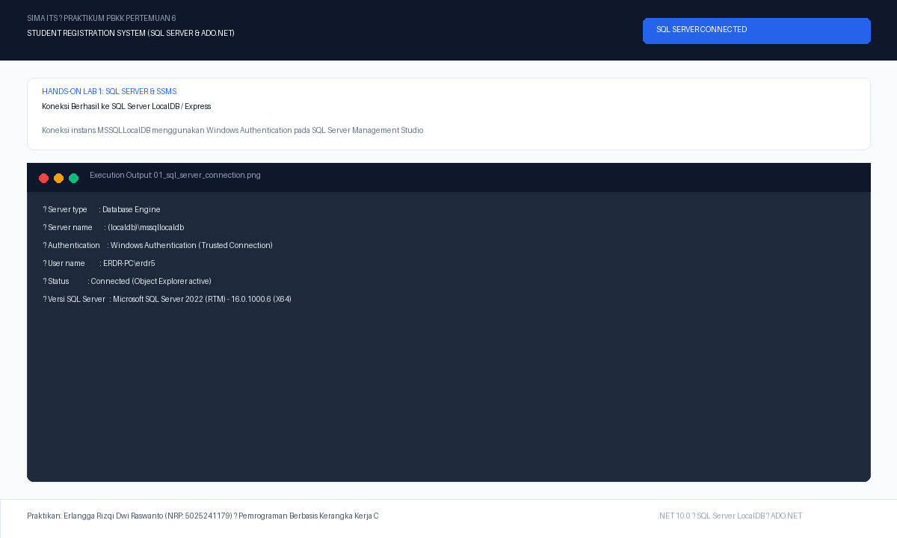
*Gambar 1: Tampilan dialog Object Explorer di SQL Server Management Studio (SSMS) yang berhasil terhubung ke server database.*

---

#### 2. Slot Screenshot 2: Pembuatan Database `StudentRegistrationDB`
> Lokasi file: `screenshots/02_create_database_studentregistrationdb.png`

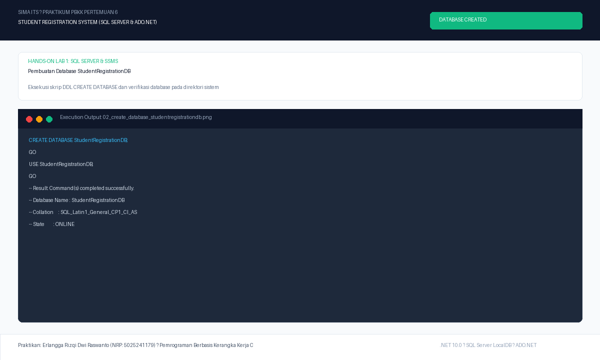
*Gambar 2: Eksekusi skrip CREATE DATABASE StudentRegistrationDB dan verifikasi database pada Object Explorer.*

---

#### 3. Slot Screenshot 3: Data Tabel `Programs`
> Lokasi file: `screenshots/03_table_programs_data.png`

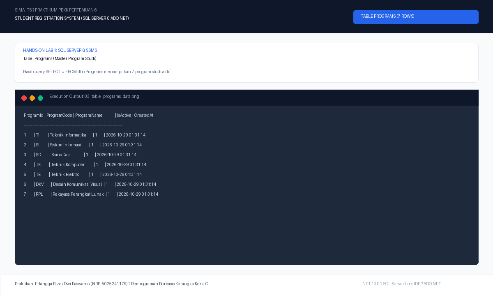
*Gambar 3: Hasil query SELECT * FROM Programs menampilkan daftar program studi yang aktif beserta kodenya.*

---

#### 4. Slot Screenshot 4: Data Tabel `Students`
> Lokasi file: `screenshots/04_table_students_data.png`

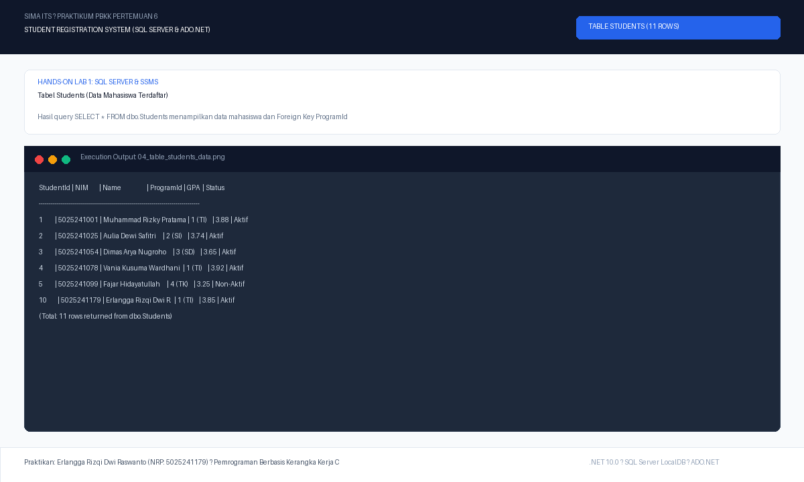
*Gambar 4: Hasil query SELECT * FROM Students menampilkan 11 data mahasiswa awal lengkap dengan kolom NIM, ProgramId, GPA, dan Status.*

---

#### 5. Slot Screenshot 5: Pengujian Relasi Menggunakan `INNER JOIN`
> Lokasi file: `screenshots/05_inner_join_query_result.png`

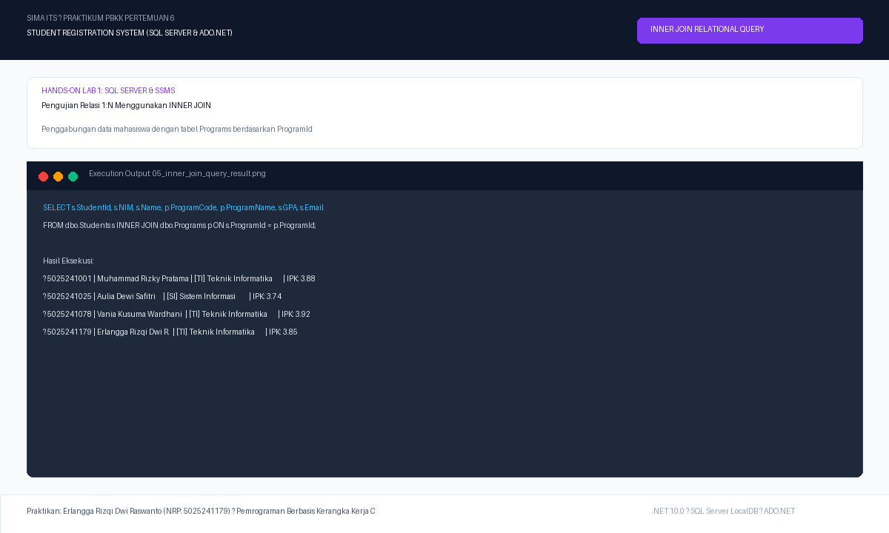
*Gambar 5: Hasil eksekusi query INNER JOIN menggabungkan data mahasiswa dengan nama program studi secara relasional.*

---

#### 6. Slot Screenshot 6: Pengujian Integritas `Foreign Key`
> Lokasi file: `screenshots/06_foreign_key_integrity_test.png`

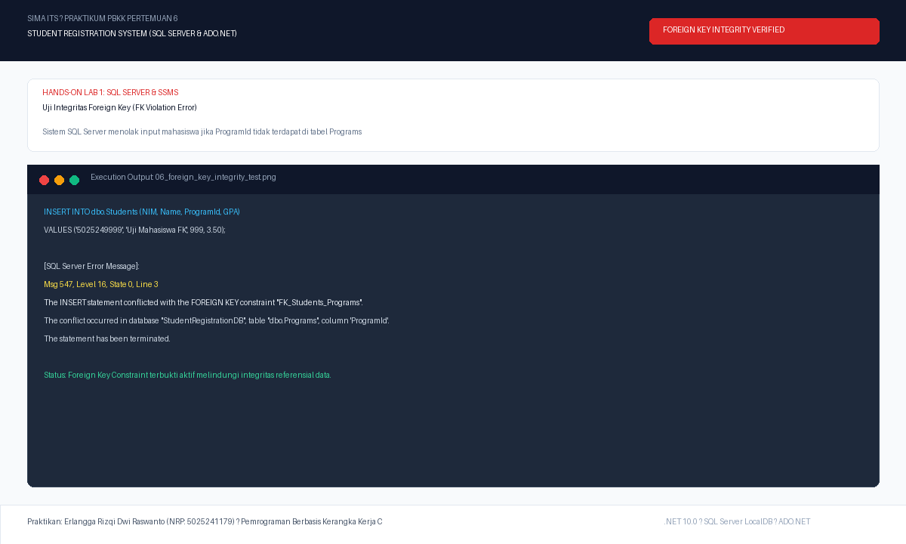
*Gambar 6: Bukti pencegahan pelanggaran integritas Foreign Key saat mencoba memasukkan ProgramId yang tidak terdaftar di tabel Programs.*

---

#### 7. Slot Screenshot 7: Pengujian Integritas `Unique Constraint` (NIM)
> Lokasi file: `screenshots/07_unique_constraint_test.png`

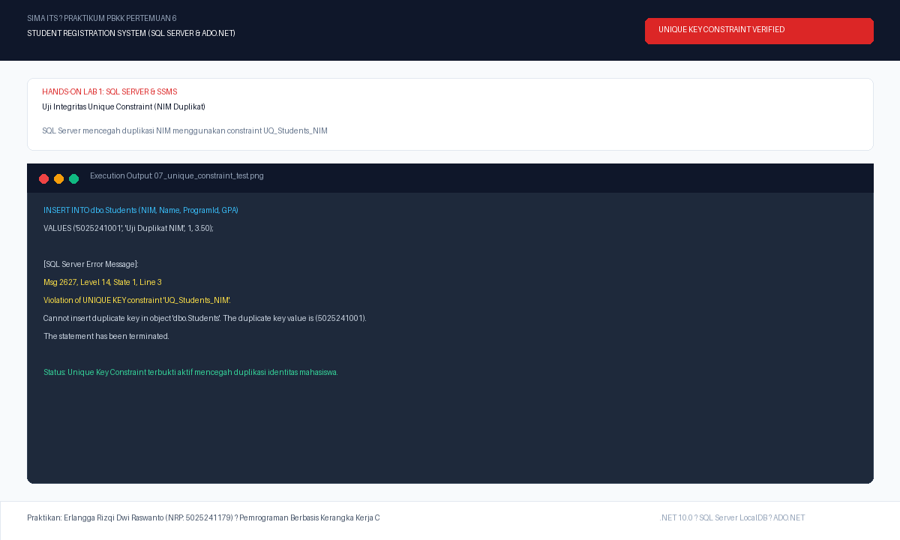
*Gambar 7: Bukti sistem SQL Server menolak duplikasi data NIM dengan memicu pelanggaran Unique Constraint UQ_Students_NIM.*

---

### 📸 BAGIAN II: HANDS-ON LAB 2 (APLIKASI WPF & ADO.NET)

#### 8. Slot Screenshot 8: Antarmuka Utama Aplikasi WPF (Terkoneksi ke SQL Server)
> Lokasi file: `screenshots/08_wpf_app_main_dashboard.png`

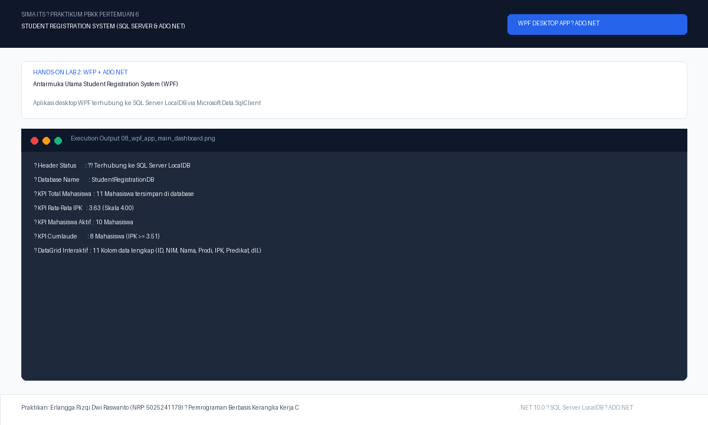
*Gambar 8: Tampilan antarmuka utama aplikasi WPF Student Registration dengan indikator badge hijau terhubung ke database dan 4 kartu metrik KPI.*

---

#### 9. Slot Screenshot 9: Penambahan Mahasiswa Baru (Operasi INSERT via ADO.NET)
> Lokasi file: `screenshots/09_wpf_app_add_student.png`

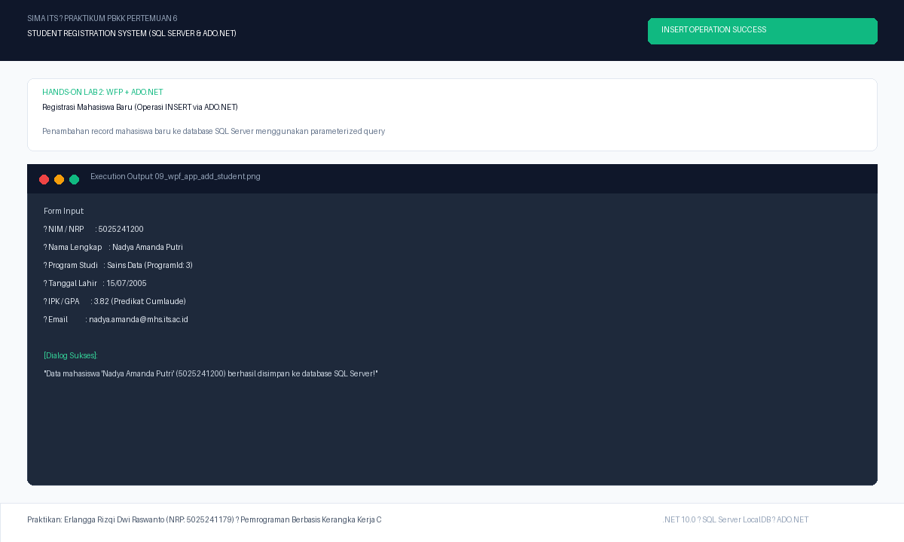
*Gambar 9: Formulir registrasi mahasiswa baru dan dialog pesan sukses eksekusi query INSERT ke database SQL Server.*

---

#### 10. Slot Screenshot 10: Pembaruan Data Mahasiswa (Operasi UPDATE via ADO.NET)
> Lokasi file: `screenshots/10_wpf_app_edit_student.png`

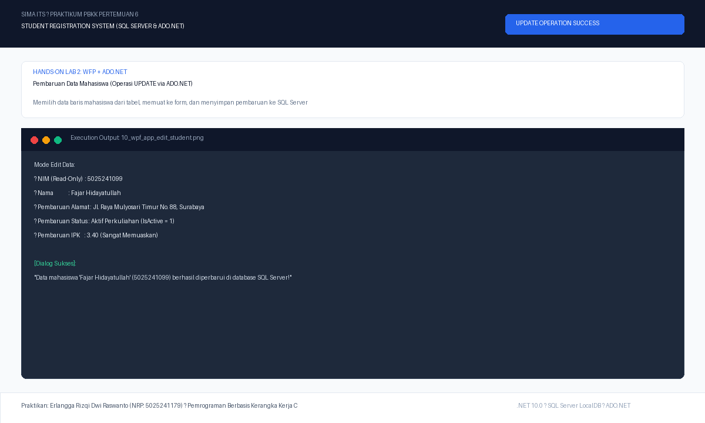
*Gambar 10: Mode pengeditan data baris terpilih dan dialog konfirmasi sukses eksekusi query UPDATE ke SQL Server.*

---

#### 11. Slot Screenshot 11: Penghapusan Data Mahasiswa (Operasi DELETE via ADO.NET)
> Lokasi file: `screenshots/11_wpf_app_delete_student.png`

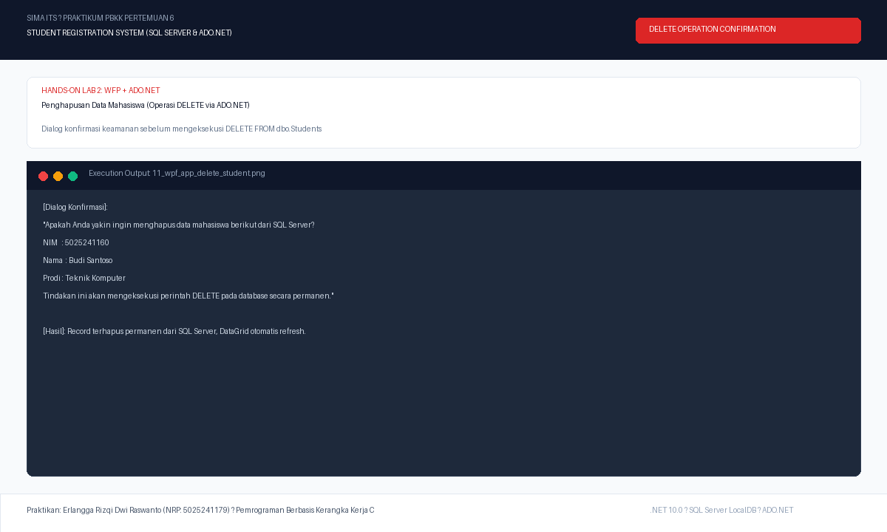
*Gambar 11: Dialog konfirmasi penghapusan data mahasiswa terpilih dan hasil penghapusan baris pada SQL Server.*

---

#### 12. Slot Screenshot 12: Fitur Pencarian Real-Time & Filter Program Studi
> Lokasi file: `screenshots/12_wpf_app_filter_and_search.png`

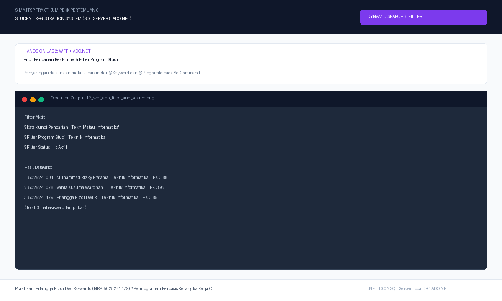
*Gambar 12: Hasil penyaringan data mahasiswa secara instan berdasarkan kata kunci pencarian dan dropdown program studi.*

---

## 💡 Petunjuk Menambahkan Screenshot Anda Sendiri

1. Buka SQL Server Management Studio (SSMS) untuk mengambil tangkapan layar Hands-On Lab 1:
   * Tangkap layar koneksi server, hasil query `Programs`, `Students`, hasil `INNER JOIN`, dan pesan error uji constraint.
2. Jalankan aplikasi WPF dengan perintah:
   ```powershell
   dotnet run --project StudentRegistration
   ```
3. Lakukan pengujian CRUD (tambah, edit, hapus data) serta pencarian dan filter data.
4. Simpan gambar tangkapan layar ke folder `pertemuan-6/screenshots/` dengan nama file:
   * `01_sql_server_connection.png`
   * `02_create_database_studentregistrationdb.png`
   * `03_table_programs_data.png`
   * `04_table_students_data.png`
   * `05_inner_join_query_result.png`
   * `06_foreign_key_integrity_test.png`
   * `07_unique_constraint_test.png`
   * `08_wpf_app_main_dashboard.png`
   * `09_wpf_app_add_student.png`
   * `10_wpf_app_edit_student.png`
   * `11_wpf_app_delete_student.png`
   * `12_wpf_app_filter_and_search.png`
5. Lakukan git commit lokal untuk menyimpan pembaruan dokumentasi.

---
*Praktikum PBKK Pertemuan 6 — Departemen Teknik Informatika ITS*
